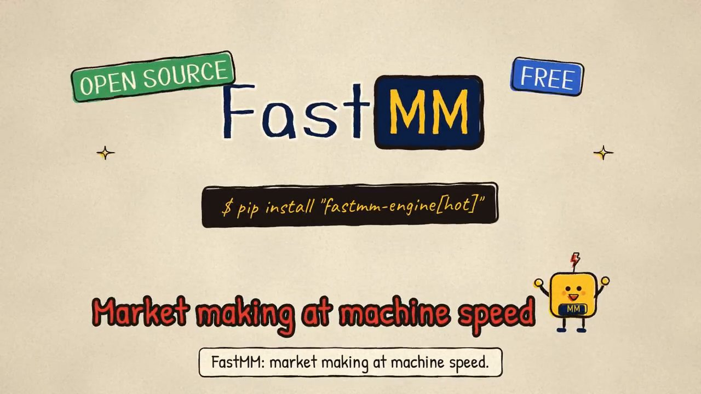
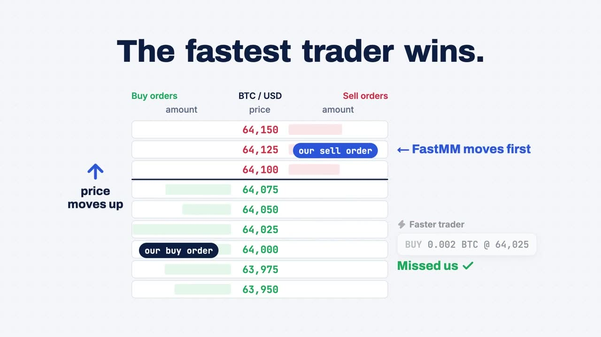
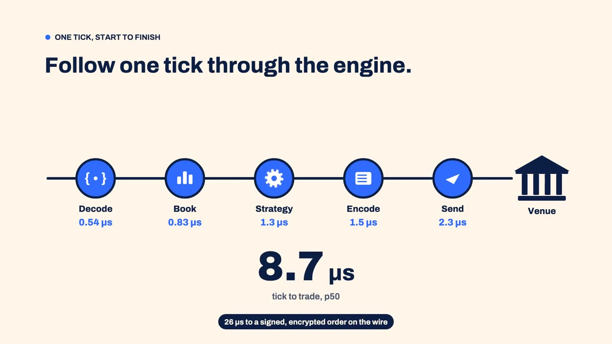

# FastMM

- **[Low latency](explanation/architecture.md#memory).** In the engine a book update becomes an order in 143 ns (p50). Core pinning, busy polling, AF_XDP or DPDK receive and OpenOnload or XLIO order entry tune the host around it.
- **[Sweeps in one pass](explanation/backtesting.md#many-runs-in-one-pass).** Thousands of parameter points share one pass over the data, and each gets the result its own backtest gives: 16,384 points over four hours of Binance BTCUSDT futures took 228 s on 8 threads.
- **[Quote on one venue, hedge on another](how-to/strategies/xmm.md).** `xmm` makes the market on one exchange and hedges each fill with an IOC on another.
- **[C++ or Python, backtest or live](how-to/strategies/python-hot-hooks.md).** One strategy file runs in backtests, replays and live sessions; replays are deterministic and the simulated exchange models queue position. Python hooks marked `@fastmm.hot` compile to machine code with Numba.
- **[Many accounts, one gateway](how-to/operations/run-behind-a-gateway.md).** Several sub-accounts trade behind one venue, and strategy processes attach to one `fastmm-gateway` that keeps the exchange connections while they restart.
- **[A/B tests](how-to/strategies/ab-test.md).** Parameter sets run side by side, split by instrument, by time block or both, and are compared on markouts and net with paired intervals.

FastMM trades on Binance (spot and USDⓈ-M futures), OKX, Bybit, Gate, Hyperliquid, Lighter, Deribit, Gemini, Coinbase (Advanced Trade and Exchange) and, for US stocks, Alpaca ([Venue connectors](reference/venues.md)).

## Quickstart

```bash
python3 -m venv .venv && . .venv/bin/activate
pip install "fastmm-engine[hot]"
fastmm init my-mm && cd my-mm
python backtest.py
```

```text
backtest py:MyMm  seed=1  md_events=7149  steps=12428  wall=0.02s
  net pnl                        -5.5272
  realized / unrealized / fees   0.5198 / 0.0005 / 6.0475
  fills (maker / taker)          1036 (1036 / 0)
  ...
```

The wheel needs Linux x86-64 and Python 3.10 or later; on Debian and Ubuntu, `sudo apt install python3-venv` first. For C++, see the [Quick start in C++](getting-started/cpp-quickstart.md) or [Build from source](getting-started/install.md#build-from-source).

The same strategy trades live against a simulated exchange on this machine:

```bash
pip install "fastmm-engine[live]"
fastmm sim &
python -m fastmm run strategy:MyMm --config sim.toml --duration 60s
```

## Films

<div class="fastmm-films" markdown>

- [**FastMM in two minutes**](https://github.com/ziyangliu-666/FastMM/releases/download/v0.5.1/fastmm-explainer.mp4)
  What a market maker does, and what FastMM does for one.
- [**The fastest trader wins**](explanation/how-fast.md)
  Why the quote that moves first keeps the fill.
- [**One tick through the engine**](explanation/how-it-works.md)
  From the market-data packet to the order on the wire.

</div>

## Dashboard

<div class="fastmm-desk">
<div class="fastmm-desk__text">
<p><strong>bndesk</strong>: a real-time, read-only dashboard for FastMM on Binance.</p>
<p><a class="md-button md-button--primary" href="https://ziy.bio/bndesk/">Live demo</a> <a class="md-button" href="https://github.com/ziyangliu-666/bndesk">Source</a></p>
</div>
<div class="fastmm-desk__row">
<a class="fastmm-desk__media" style="--r: 1.6" href="https://ziy.bio/bndesk/"><video autoplay loop muted playsinline preload="metadata" poster="assets/bndesk-desk.jpg" src="assets/bndesk-desk.mp4"></video></a>
<a class="fastmm-desk__media" style="--r: 1.6" href="https://ziy.bio/bndesk/"><video autoplay loop muted playsinline preload="metadata" poster="assets/bndesk-orders.jpg" src="assets/bndesk-orders.mp4"></video></a>
<a class="fastmm-desk__media" style="--r: 0.4615" href="https://ziy.bio/bndesk/"><video autoplay loop muted playsinline preload="metadata" poster="assets/bndesk-phone.jpg" src="assets/bndesk-phone.mp4"></video></a>
</div>
</div>

## Where to go next

- [Quick start](getting-started/quickstart.md): a Python strategy, a backtest and a live session against the local exchange.
- [Quick start in C++](getting-started/cpp-quickstart.md): a C++ strategy backtested from a CMake project.
- [Quote on one venue, hedge on another](how-to/strategies/xmm.md): run `xmm` on Binance Demo.
- [Run in production](how-to/operations/running-in-production.md): what to set before a keyed session runs unattended.
- [How FastMM works](explanation/how-it-works.md): the engine thread, the path of one event and what it guarantees.
