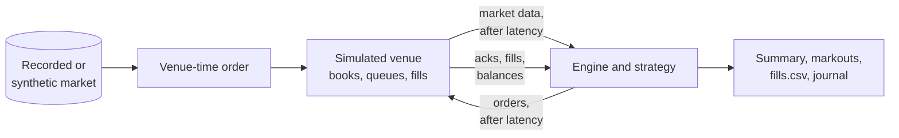
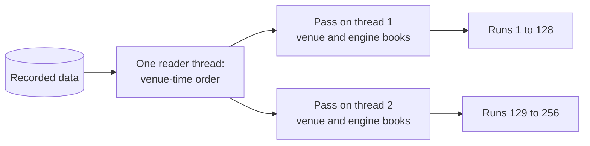

# Backtesting

`fastmm-backtest` prints the net PnL, where it came from, and what each fill was worth afterwards. Read the decomposition and the markouts before the net PnL: a passive quoter can show positive spread capture and positive net PnL while losing on every fill.



## Model assumptions

The simulated venue models latency and book mechanics. It assumes four things about the market:

| Assumption | Consequence |
|---|---|
| Your orders have no market impact: the flow does not react to your quotes | Fill rates and queue positions are optimistic; in a real book the size you add changes who trades with you |
| The synthetic mid is a symmetric random walk with no drift and no autocorrelation | Adverse selection only appears through the queue and the latency, never because the flow knew something |
| The counterparty side of each synthetic order is a coin flip | Order flow carries no information: a strategy that predicts flow measures as worthless here, one that ignores it as fine |
| There is no informed flow and no toxic counterparty | The markouts measured here are a floor on the adverse selection you will see live, not an estimate of it |

The fill model decides how a resting order fills ([Configuration](../reference/configuration.md#backtest)):

| `fill_model` | Data | A resting order fills when |
|---|---|---|
| `matching` (default) | synthetic or recorded | an incoming order matches it in the venue's own matching engine; the market goes on from the book our orders changed |
| `l2_queue` | price levels | the trades at its price exceed the queue ahead of it, a trade prints through its price, or the opposite side of the book comes to it |
| `l3_queue` | every order ([`itch`](../reference/data-sources.md#itch)) | the recorded orders ahead of it are gone and an execution reaches it ([The queue from every order](#the-queue-from-every-order)) |

The synthetic market's shape is set in bps of its starting mid ([`[sim]`](../reference/configuration.md#sim)). By default its book is 1.7 to 3.4 bps wide, and a quote inside the touch captures most of a basis point a fill, less than a 10 bps fee. `configs/backtest-example.toml` keeps the one-tick market its fixtures record: 0.003 bps wide at a mid of 60,000 USDT and a tick of 0.01 USDT. There no passive strategy captures more than a fraction of a basis point.

### How an order fills on recorded levels

The simulated venue checks a post-only order, and fills a taker, against its book at the order's arrival in venue time. The depth stream is throttled and can miss the removal of a level, so where the book ticker is newer, the venue uses the ticker's touch.

| Step | Rule |
|---|---|
| Queue position at arrival | the displayed quantity at the order's price, less what trades took since, capped by a newer book ticker's touch |
| Fill from a trade | a trade at its price beyond the queue ahead, or any trade through its price |
| Fill from a crossing book | the opposite side reaches its price: the order fills as maker with the new quantity at or through its price (`cross_fills` in the run's venue statistics) |

The crossing-book rule matters. An ask recorded at or below our resting bid would have traded with our bid before it rested, and the recording has no print for it. Without the rule, a bid the price fell through waited for a seller below it, and a cancel sent as the market moved won a race it lost live. `ctx.queue_ahead` gives the strategy the same queue estimate on the data it sees ([Strategy API](../reference/strategy-api.md#execution-view)). [Calibrating against live sessions](#calibrating-against-live-sessions) measures how close the model comes.

## Our orders in the feed

A live venue's depth and book ticker show our resting orders, so a strategy reading the touch sees its own quote there. With recorded data the simulated venue does the same (`[backtest] own_orders_in_feed`, on by default). The synthetic market's book holds our orders in any case.

| In the book the strategy reads | Shown as |
|---|---|
| A recorded level where we rest | the recorded quantity plus ours |
| A price of ours with no recorded level | a level of its own, past the 256 a side if need be |
| The book ticker's top | the better of the recorded top and our best order, summed at the same price |
| Our quantity at or through the recorded opposite touch | not shown: a live venue would have matched it |

Without it a strategy acts on a book a live venue never showed. `lead_mm` never improves on its own order, because a live book shows it at the touch. When the level it had improved on goes, a feed without our order shows the next level as the touch, and the strategy chases it down and back with a cancel and a new order each time.

The recorded messages themselves are never changed, so every run over the same data reads the same messages ([Many runs in one pass](#many-runs-in-one-pass)). `ctx.own_qty` follows our quantity in the feed as on a live venue.

## Venue time

A recording is in receive order, and its streams reach the recorder with different delays. In a recorded Binance Spot session, 46 % of trades arrive after a book ticker the venue stamped later: by 0.5 ms at the median, 40 ms at the 99th percentile. Replayed in that order, a trade printed before an order arrived could fill it.

The simulated venue therefore takes recorded events in venue-time order. An event waits until no unread event can be earlier, assuming none was received more than `[backtest] reorder_window_ms` (default 1000 ms) after its venue time. The strategy still gets events in recorded order, and at their recorded times under `md_arrival = "recorded"`.

The run's report counts the events reordered and those later than the window. A trade later than the window still fills only orders that had arrived by its time.

## Reading the summary

The decomposition is exact:

```text
net = gross spread capture + mid drift after the fills − fees paid + rebates received + unexplained
```

`mid drift` is `signed qty * (final mid − mid at fill)` summed over the fills: the adverse selection over the whole run plus the mark of the inventory still open at the end. `unexplained` is the difference from the ledger's own net PnL. On a healthy run it is fixed-point rounding; anything larger means the split is wrong, not the ledger.

`basic_mm` from `configs/backtest-example.toml` on the synthetic market, 60 s, seed 1, at Binance spot VIP 0 fees:

```bash
./build/release/bin/fastmm-backtest --config configs/backtest-example.toml \
    --data synthetic --out -
```

<!-- output: fastmm-backtest --config configs/backtest-example.toml --data synthetic --out - -->
```text
  net pnl                        -12.1548
  fills (maker / taker)          147 (147 / 0)
  spread captured (bps)          0.008
  realized spread (bps of notional) 0.008
  maker fills at / inside / behind / through 6.8% / 30.6% / 60.5% / 2.0%
  orders filled / sent           105 / 365 (28.8%)
  time to fill p50/p90/p99       44.1 / 271.8 / 1100.2 ms
  queue ahead at fill p50/p90    0.00000 / 0.00102

where the PnL came from (quote currency, 12163.49 traded notional)
  gross spread capture                 0.0093  +0.008 bps of 11803.49, over the 144 of 147 fills that had a venue mid
  mid drift after the fills           -0.0006  adverse selection + the open inventory, marked at the final mid
  fees paid                          -12.1635
  rebates received                     0.0000
  = net                              -12.1548
  reported net pnl                   -12.1548
  unexplained                         -0.0000  fixed-point rounding, or something this split does not model

markout per fill (mid at fill + horizon vs the fill price; bps of notional)
  horizon     markout     mo bps    capture    cap bps    adv.sel    fills past end   no mid
  1s           0.0081     0.0079     0.0078     0.0076    -0.0003      126       18        3
  10s          0.0067     0.0076     0.0066     0.0075    -0.0001      111       33        3
  1m           0.0000     0.0000     0.0000     0.0000     0.0000        0      147        0
```

`first_mm` from the tutorial (`examples/cpp/tutorial/first_mm_backtest.cpp`, 60 s, seed 7, same fees) on the matching fill model:

<!-- output: first_mm_backtest -->
```text
  net pnl                        -27.0083
  fills (maker / taker)          467 (467 / 0)
  realized spread (bps of notional) 0.002
  maker fills at / inside / behind / through 78.4% / 0.0% / 0.0% / 0.0%
  orders filled / sent           456 / 762 (59.8%)
  queue ahead at fill p50/p90    n/a (the matching fill model has no queue position)

where the PnL came from (quote currency, 27014.99 traded notional)
  gross spread capture                 0.0046  +0.002 bps of 20974.79, over the 366 of 467 fills that had a venue mid
  mid drift after the fills            0.0021  adverse selection + the open inventory, marked at the final mid
  fees paid                          -27.0150
  = net                              -27.0083

markout per fill (mid at fill + horizon vs the fill price; bps of notional)
  horizon     markout     mo bps    capture    cap bps    adv.sel    fills past end   no mid
  1s           0.0053     0.0026     0.0044     0.0022    -0.0004      351        9      107
  10s          0.0040     0.0024     0.0037     0.0022    -0.0002      295       80       92
```

Neither strategy has a measurable gross edge. They capture 0.008 and 0.002 bps of traded notional against a 10 bps maker fee, so both pay three to four orders of magnitude more in fees than they earn. Their markouts are within rounding of their capture, as the random-walk mid guarantees; near-zero adverse selection here says nothing about live.

| Variant of the `basic_mm` run | Result |
|---|---|
| 600 s instead of 60 s | trips the `max_loss = 100` kill switch on fees alone after about 80 s of trading |
| `maker_bps = -0.5` (a 0.5 bps rebate) | nets +0.6383, of which 0.6292 (98.6 %) is the rebate and 0.0091 the spread |
| `avellaneda_stoikov` at its default `gamma` and `kappa` | never fills on this market, so has no markout |

## Markouts

A market maker's fill is worth the spread it captured minus what the mid took back afterwards. For a fill of signed quantity `s` (positive bought) at price `p` and time `t`, with venue mid `m`:

```text
spread capture       = s * (m(t) - p)
markout(h)           = s * (m(t + h) - p)
adverse selection(h) = spread capture - markout(h)
```

Spread capture is positive by construction for a passive quoter: it quotes away from the mid, so it fills away from the mid. Only the markout says whether the fills were worth taking. A capture of +1 bps with a markout of −3 bps at 10 s means the strategy paid 4 bps to be filled.

The horizons are `[backtest] markout_horizons_s` (default `"1,10,60"` seconds). The run stops at every fill time plus horizon and reads the venue mid there, so nothing is interpolated. A fill the run cannot mark is dropped from that horizon and counted, never marked at a substitute price:

| Column | The fill is dropped because |
|---|---|
| `past end` | `t + h` is after the run's last event; a 60 s markout on a 60 s run measures nothing |
| `no mid` | the venue book had one side only, at `t + h` or at the fill |

Under `l2_queue` the book holds only the levels the feed published, so it empties on one side when the price moves past the recorded depth. Under `matching` the synthetic market orders are larger than its limit orders, so a sweep that fills a quote often empties that side: a fifth to a half of the fills have no mid. Such a fill's whole `s * (final mid − p)` goes to mid drift, since none of it can be called capture.

The capture column is recomputed per horizon over the same fills as its markout, so the two columns of one row compare. Markouts are reported per instrument, side and liquidity, in total, in quote currency and in bps of traded notional:

| Where | What |
|---|---|
| CLI summary | a `maker` and a `taker` row under the total when a run has both; a row per `venue:symbol` when more than one traded |
| `summary.json` | `markouts` |
| Python | `result.markouts()`, `fastmm.markout_frame(result)` |
| `fills.csv` | `mid_1s`, `mid_10s`, `mid_1m` per fill |
| A live session | `tools/pnl_report.py` on its journal, marked against the book ticker ([Journals, replay and PnL](../how-to/operations/journals-replay-pnl.md)) |

## Fill quality

| Metric | Meaning |
|---|---|
| realised spread | `signed qty * (mid at fill − price)` over the traded notional, in bps: the quantity the markout starts from |
| maker fills at / inside / behind / through | where a resting order's price sat against the book when it filled: at the best quote, better, worse, or at or beyond the opposite quote. Through fills come from the [crossing-book rule](#how-an-order-fills-on-recorded-levels) and are the most adversely selected |
| orders filled / sent | new orders that got at least one fill, their replacements' fills included; `fills per order` counts every fill, so it can exceed 1 |
| time to fill | venue arrival of a new order to its first fill, p50 / p90 / p99 |
| queue ahead at fill | displayed quantity still ahead of the order when it filled; `l2_queue` only, since the matching engine fills from the front |

## Fees and rebates

Fees are centi-basis-points of the fill notional. A positive rate is a fee the account pays, a negative rate a rebate it receives and which raises net PnL. Each instrument pays its venue's `[venues.<name>.fees]`, and `[[instruments]] maker_bps` / `taker_bps` override one instrument ([Configuration](../reference/configuration.md#venuesfees)).

`configs/backtest-example.toml` charges Binance spot VIP 0: 0.100 % maker and taker, 10 bps each side. Check a rebate against the venue's published schedule. Binance spot pays no maker rebate at VIP 0, and a configured `maker_bps = -0.5` adds 0.5 bps to every passive fill, more than any strategy in this repository captures gross.

## Several venues

A run can quote an instrument on venue A and hedge another on venue B. Each venue has its own latency model, order and market-data connection, and replace and STP settings ([`[backtest.venues.<name>]`](../reference/configuration.md#backtestvenues)). Quotes on a venue with replace are amended in place; on one without, cancelled and sent again.

Recorded feeds are merged by event time: `--data "binance:BTCUSDT,2024-03-27,venue=0; csv:other.csv,venue=1"`, or a list in Python. Each source's `venue=` is the venue of its instruments in `[venues]` order. The clocks are taken as they are: a feed stamped at receive time and one stamped at venue time interleave wrongly by the difference.

With more than one instrument, `equity.csv` gains `pnl_<id>`, `position_<id>`, `mid_<id>` and `quoted_<id>` per instrument (`result.equity_by_instrument` in Python). `pnl` is in the instrument's settlement currency; `position` and `mid` stay the sum over instruments and instrument 0's mid. The synthetic market drives instrument 0 only.

## Balances

With `[backtest.balances]` ([Configuration](../reference/configuration.md#backtestbalances)) each simulated venue keeps the strategy's account:

| Instrument | Held by an order | A fill |
|---|---|---|
| spot buy | notional at the order price, in the quote asset; a market buy holds what it would pay for the levels it takes | adds the base, takes the notional and the fee from the quote |
| spot sell | quantity, in the base asset | takes the base, adds the notional less the fee to the quote |
| derivative | notional × `[[instruments]] initial_margin` of the larger side of the instrument's orders; nothing for an order that only reduces the position | locks the position's margin at its entry price; closing realises PnL into the wallet; the fee comes out of it |

| Order | Venue answer |
|---|---|
| holds more than the free balance | `InsufficientBalance` (venue code `-2010`) |
| a replace whose new leg does not fit | the order is cancelled and the new one refused |
| reduce-only derivative on a flat position, or on the side that adds to it | `VenueReject` (venue code `-2022`); under `matching` it fills down to flat and the rest expires |

A derivative's free margin counts the position's unrealised PnL at the recorded mark price, or at the mid in data without one. The venue reports balances after each event that moved an asset, as a live venue does, so `[risk] check_balance`, `ctx.balance` and the strategies' sizing work as live ([Risk model](risk-model.md#balance-check)). With `check_balance = false` the order goes out and the venue refuses it.

`balances_from_journal = true` starts each account from the first balance snapshot of the journal the backtest runs over. Money moved in or out during the session (`AccountFlow` in the journal) moves the simulated account at its time, and the venue's full refreshes reset the engine's estimate as they did live.

## Many runs in one pass

<video class="fastmm-video" autoplay loop muted playsinline preload="metadata" poster="../../assets/anim/backtest-sweep.jpg" src="../../assets/anim/backtest-sweep.mp4"></video>

Under the queue fill models the recorded market does not depend on our orders. A sweep's points, a walk-forward's folds and the arms of an `[ab]` test therefore share one pass over the data. Each point still gets the result its own backtest would: the same fills, orders, equity bars, markouts and outbound hash.



| Shared by the runs of a pass | Kept per run |
|---|---|
| the data, read once and put in venue order | the engine and strategy |
| the venue's books and, under `l3_queue`, every recorded order | the simulated venue links, accounts and orders |
| the market data the engines read, when their latency settings match | latency draws and seed |
| the engine books | results |

A recorded event reaches only the runs whose orders it can touch. A strategy is called only when something it declared changes: its instruments and mid band (`watch`, `quiet_book`, [Strategy API](../reference/strategy-api.md#context)). One that declares nothing is called on every message and shares only the data and the books; the results are the same either way ([Sweep performance](sweep-performance.md#one-thread)). A hot Python strategy declares its band with `ctx.quiet_book` ([Python strategy API](../reference/python-api.md#ctx)).

### Running a sweep

```bash
./build/release/bin/fastmm-backtest --config configs/backtest-binance.toml \
    --data "tardis:binance-futures,BTCUSDT,2026-09-01,end=04:00" \
    --sweep half_spread_bps=1,2,4 --sweep quote_qty=0.002,0.004 --verify 4
```

| Entry point | Shares passes when |
|---|---|
| `fastmm-backtest --sweep`, `--folds K` | the fill model is `l2_queue` or `l3_queue`; `--solo` runs each point alone |
| `fastmm.sweep`, `fastmm.walk_forward` (each fold in its own passes) | the same, and the strategy is C++ or has `@fastmm.hot` hooks |
| `bt::sweep_by_name`, `bt::walk_forward_by_name`, `bt::run_multiverse` | the same |

Under `matching` each point is a backtest of its own; the sweep's first line says which way its points run. `--verify N` (`verify=N` in Python) runs N points again alone and fails on the first difference. The test suite compares every shipped strategy this way under both queue models.

A sweep runs one pass per thread (`--threads N`, `threads=N`; default every core), plus one thread that reads the data. A pass holds at most 128 runs. A sweep with more points than its passes hold goes in waves, each reading the data again, and only the wave under way is in memory. Points keep no order rows; their metrics, fills and equity bars stay. [Sweep performance](sweep-performance.md) has the time, memory and scaling numbers.

A point sets strategy parameters and these backtest settings; a venue with its own `[backtest.venues.<name>]` latency keeps it, and a fee applies to every instrument:

| Latency | Fill model | Fees |
|---|---|---|
| `latency_fixed_us`, `latency_jitter_us` | `queue_conservatism` | `maker_fee_bps` |
| `latency_md_us`, `latency_md_jitter_us` | `p_drop` | `taker_fee_bps` |

`--sweep latency_fixed_us=2000,10000 --sweep queue_conservatism=0,1 --sweep maker_fee_bps=-0.5,0` checks a choice against the model's assumptions in the same passes.

`fastmm-backtest --sweep` prints a line per point: net PnL, fills, orders, risk rejects, outbound hash and the kill switch's reason if it tripped. Its runs log errors only, each line naming its point (`#n`). With `--out` it writes `sweep.jsonl`, one line per point: its values under `point`, then its `summary.json`. `--folds K` runs the grid as a walk-forward ranked by `--metric` ([Walk-forward](../python.md#walk-forward)) and adds `fold` to each line.

## The queue from every order

An L2 feed shows how much rests at a price, never in what order. So `l2_queue` has to guess what a shrinking level means for an order inside it:

| `queue_conservatism` | A cancel at our price is taken from |
|---|---|
| 0 | the orders ahead and behind, in proportion |
| 1 (default) | the orders behind us |

A day of Nasdaq TotalView-ITCH settles the question, because it shows every order and what became of it. On 2019-07-30, 100 most active stocks, continuous session, each order that joined the touch was run through the model and compared with what ITCH executed against it ([method](../../bench/README.md#queue-models-against-itch)):

| Orders joining the touch | Orders filled in truth | Filled by the model too | Filled by the model only | Filled quantity, model / truth | Markout at 10 s, model fills | Same, true fills |
|---|---:|---:|---:|---:|---:|---:|
| `l2_queue`, conservatism 0 | 629,373 | 587,343 | 38,693 | 0.99 | −0.474 bps | −0.477 bps |
| `l2_queue`, conservatism 0.5 | 629,373 | 498,137 | 20,239 | 0.81 | −0.492 bps | −0.477 bps |
| `l2_queue`, conservatism 1 | 629,373 | 289,803 | 0 | 0.44 | −0.486 bps | −0.477 bps |
| `l3_queue` | 629,373 | 629,373 | 0 | 1.00 | −0.477 bps | −0.477 bps |

Of 13.5 million orders that joined the touch, 4.7 % were filled. The proportional rule fills the right quantity overall, and its fills are as toxic as the true ones. But of the orders either filled, one in eight is filled by one and not the other. At conservatism 1 it fills fewer than half the filled orders; one level behind the touch, a third. Orders that improve the touch have nothing ahead and fill alike under every setting.

`fill_model = "l3_queue"` needs no such rule. It keeps every recorded order with its place in the arrival sequence, and ours takes the next place when it reaches the venue:

| Event | Effect on our order |
|---|---|
| cancel or execution of an order ahead | moves it up |
| cancel of an order behind | none |
| execution of an order behind, or at a worse price | an aggressor that met ours first: fills it |
| execution at a better price than ours | never reached us |

Run on each real order as if it were ours, this rule reproduces all 629,373 fills and adds none. Nasdaq's book is strictly first in, first out among displayed orders, once one detail is kept: an order that would lock the market is displayed a tick away but executes at the locking price. Like every replay, the rule assumes our order does not change what others do.

## Calibrating against live sessions

`fastmm-data calibrate` fits the `l2_queue` fill model and the simulated latency to journals recorded by `fastmm-live`, and prints the `[backtest]` keys to use:

```bash
./build/release/bin/fastmm-data calibrate sessA.fmj sessB.fmj sessV.fmj --backtest
```

For each session it replays the orders that rested through the queue model, once per `queue_conservatism` (`--conservatism`, default `0,0.25,0.5,0.75,1`), and counts orders by whether they filled live and in the model ([fill check](../how-to/operations/journals-replay-pnl.md#check-the-fill-model-against-live-fills)):

```text
  conservatism     both   live  model   none    hit   miss  false  error model/live
  0.00              151      2      0   1573  0.987  0.013  0.000  0.013      0.987
  ...
  1.00              151      2      0   1573  0.987  0.013  0.000  0.013      0.987
  no ticker         144      9      1   1572  0.941  0.059  0.001  0.065      0.940
  no tape           150      3      0   1573  0.980  0.020  0.000  0.020      0.981
  neither           127     26      1   1572  0.830  0.170  0.001  0.175      0.795
```

| Column or row | Meaning |
|---|---|
| `hit`, `miss` | share of live fills the model also fills, and the rest |
| `false` | share of orders not filled live that the model fills |
| `error` | (live only + model only) over the orders filled either way; the fit minimises it, then `model/live` nearest 1, then prefers the larger conservatism |
| `no ticker`, `no tape`, `neither` | the fitted value without the book ticker, without the trades since the depth update, or both: what each input is worth |

The conservatism is cross-validated: fitted on each session and scored on the others. When every value scores the same, the data does not identify it and 1 is kept; queues at or inside the touch are set by the book ticker, where the conservatism does not act.

The fitted keys look like this:

```text
[backtest]
fill_model = "l2_queue"
queue_conservatism = 0.75
md_arrival = "recorded"
latency_fixed_us = 360
latency_jitter_us = 300
latency_sigma = 0.5
latency_ack_us = 375
latency_ack_jitter_us = 160
latency_ack_sigma = 0.5
latency_cancel_us = 200
latency_cancel_jitter_us = 250
latency_cancel_sigma = 0.5
order_service_us = 220
```

With several venues, including a pool's accounts, the latency keys go under `[backtest.venues.<name>]`, one table per venue. `md_arrival = "recorded"` delivers market data to the strategy when the session received it.

| Latency key | Fitted from |
|---|---|
| `latency_*_us`, `latency_*_jitter_us` | each order's send time, the venue's time on its ack and the ack's arrival; each leg is a fixed part plus a lognormal excess of shape `latency_*_sigma` |
| `latency_cancel_*` | at least 20 isolated cancels, timed by their cancel acks |
| `order_service_us` | messages sent within 1 ms of the one before, which wait for the venue to take that one in |

On Binance Spot a burst of cancels on one connection is taken in about 0.25 ms apart, so the tenth cancel reaches the book some 2 ms after the first. The round trip's tail, a p99 of 40 ms in a live Binance Spot session, is beyond this model.

When a cancel path or service time is fitted, the fill check runs twice more with cancels replayed. `cancels, before` sends them through the order path alone; `cancels, fitted` through everything fitted. The strategy's decisions are those it made live, so the two rows measure the cancel race alone.

`--backtest` then re-runs each session over its journal with our orders stripped, once with its configuration's `[backtest]` and once with the fitted keys. It prints both beside the live session: orders, rejects, fills, time to fill, the PnL decomposition and markouts. This adds everything a backtest re-decides on top of the fill model, such as how often the strategy requotes. `--from-live-state` starts both runs from the session's recorded state ([below](#starting-from-the-live-sessions-state)); `--csv` writes the fill-check grid.

A live commission paid in a third asset such as BNB has no price in the journal. The live fees and net leave it out, as the engine does, and a line under the table gives those fills and their commission.

## Starting from the live session's state

A strategy that adapts as it trades carries its state across sessions through `state()`, `restore()` and `[strategy] state_file`. Started fresh over a live journal, it quotes elsewhere until it has learnt again, and the gap to live says little about the fill model. So the journal records what a session starts from ([Journal format](../reference/journal-format.md#strategy-state)):

| Record | Holds |
|---|---|
| restored state | the bytes handed to `restore()` at the start, and whether the strategy took them |
| checkpoint, every `[engine] checkpoint_s` | the strategy's `state()`, the engine's positions and open orders |
| reconciliation | the positions restored from the store and reported by the venues before the first order |

`[backtest] initial_state = "journal"` starts the strategy from the restored state, else the first checkpoint, and the positions from that checkpoint or the reconciliation. The run's log names what it started from; a journal without these records starts fresh and flat. `params_from_journal = true` replays the session's parameter changes at their times. `fastmm-replay` also restores the state, so such a session replays exactly.

## Starting inside a live session

`[backtest] start_at` starts trading at the last checkpoint at or before that time. A backtest of an hour in the middle of a session then starts where the session was: its positions, balances and what its strategy had learnt. The run still reads the journal from its start, so the books warm up; the engine refuses orders until the checkpoint.

At the checkpoint:

1. The strategy restores the checkpoint's bytes, as a warm standby does at take-over.
2. Every venue reconciles with the checkpoint's positions.
3. With `balances_from_journal`, each account starts from its last reported balances.
4. The strategy quotes anew at the back of each queue; the checkpoint's open orders are not placed again.

A run from a checkpoint is deterministic and its journal replays bit for bit. With jittered latencies it parts from the session at the first random draw. For a journal without checkpoints, `[backtest.positions]` gives the positions ([Configuration](../reference/configuration.md#backtestpositions)).

A venue slows down when the market does, while the latency model draws from one distribution. A cancel that wins its race in the model may have lost it live. `[backtest] latency_from_journal` makes each simulated message take the live delay at the same moment, where that is longer than the model's draw. It uses the order sent within 2 ms on the same account and instrument, else the nearest one; a reply takes the nearest reply.

## See also

* [Configuration](../reference/configuration.md#backtest): every `[backtest]` and `[sim]` key
* [Command lines](../reference/cli.md#fastmm-backtest): flags of `fastmm-backtest`
* [Determinism](determinism.md): why two runs of the same configuration send the same orders
* [Journals, replay and PnL](../how-to/operations/journals-replay-pnl.md): `tools/pnl_report.py` on a live session
* [Simulated exchange](../reference/sim-exchange.md): the venue model the backtest and `fastmm-sim-exchange` share
