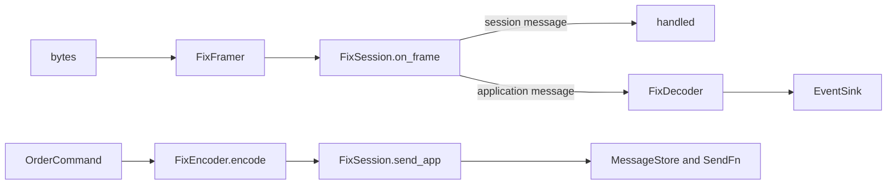

# FIX 4.4 codec (`fastmm::codecs::fix`)

!!! note "Not in the default build"

    No connector speaks FIX yet. The codec builds only with `-DFASTMM_CODEC_FIX=ON`, and its tests and benchmark follow the same option. A `Venue` over it needs a transport and a symbology.

A tag=value FIX 4.4 codec: framing, a session layer for initiators and acceptors, and a decoder and encoder between FIX messages and the engine's messages. It has no XML dictionary; the tags and enumerations it uses are constants in `include/fastmm/codecs/fix/fix_tags.hpp`. It depends on core only, and its hot path is `noexcept` and allocation-free after construction.

| Header | Type | Concept |
|---|---|---|
| `fix_framer.hpp` | `FixFramer` | `codecs::Framer` |
| `fix_view.hpp` | `FixView`, `FixRange`, `FixGroupReader` | |
| `fix_builder.hpp` | `FixBuilder` | |
| `fix_session.hpp` | `FixSession`, `FixSessionConfig` | `codecs::SessionLayer` |
| `message_store.hpp` | `MessageStore` | |
| `fix_decoder.hpp` | `FixDecoder` | `codecs::Decoder` |
| `fix_encoder.hpp` | `FixEncoder` | `codecs::Encoder` |
| `fix_symbols.hpp` | `FixSymbolTable` | |
| `fix_time.hpp` | `parse_utc_timestamp`, `format_utc_timestamp` | |
| `fix.hpp` | umbrella and concept `static_assert`s | |

## Wire format

`8=FIX.4.4|9=<BodyLength>|35=<MsgType>|...|10=<CheckSum>|`, where `|` is SOH (0x01).

| Rule | |
|---|---|
| First three fields | BeginString(8), BodyLength(9), MsgType(35) |
| BodyLength | bytes after the SOH ending field 9, up to `10=` |
| CheckSum | sum of every byte before `10=`, modulo 256, three digits |
| Values | never empty |
| Data fields | SecureData(91), RawData(96), XmlData(213) and EncodedText(355) may contain SOH; the preceding length field gives their length |
| UTCTimestamp | `YYYYMMDD-HH:MM:SS[.sss]`; the parser also takes 6 and 9 fraction digits, the builder writes milliseconds |

| Type | Does |
|---|---|
| `FixFramer` | finds `8=FIX`, reads BodyLength, checks that the CheckSum field sits where it says; returns `kMessage` or `kGarbage` frames, or "need more". Garbage, a non-numeric BodyLength, a misplaced CheckSum or a message over `max_message` (64 KiB) are skipped to the next `8=FIX` |
| `FixView::parse` | validates framing and CheckSum, then indexes every field as (tag, offset, length) into the caller's bytes; tags below 1024 look up in O(1) |
| `FixView` getters | return `std::optional`: `get_int`, `get_char`, `get_bool` (Y/N), `get_price` and `get_qty` (exact to 1e-8; `+` and exponents refused), `get_timestamp_ns` |
| `FixGroupReader` | walks a repeating group: an entry starts at the group's first tag and ends at the next first tag, a tag outside the member list, or CheckSum; `complete()` checks NumInGroup |
| `FixBuilder` | writes into a caller buffer; `begin_header(type, sender, target, seq, now)` emits 8, 9, 35, 49, 56, 34, 43 and 122 on retransmissions, and 52; `finish()` writes BodyLength and CheckSum; overflow latches `!ok()` and `finish()` returns 0 |

## Session layer

`FixSession(cfg, send, ctx)` runs one session. `set_clock()` supplies SendingTime, else the last `on_timer` time. `set_event_callback()` reports logon, disconnect, gap detected and gap filled. `SendFn` must not call back into the session.

| Message | Behaviour |
|---|---|
| Logon (A) | the initiator's `logon(now)` sends EncryptMethod(98)=0, HeartBtInt(108), and ResetSeqNumFlag(141)=Y with `reset_seq_num_on_logon`, which restarts both sequences and clears the store. The acceptor adopts HeartBtInt, resets on 141=Y and answers. No valid HeartBtInt: refused. `logon_timeout_ns` bounds the wait |
| Heartbeat (0) | sent after HeartBtInt with nothing sent; echoes TestReqID(112) |
| TestRequest (1) | sent after HeartBtInt plus `transmission_grace_pct` (20 %) with nothing received; disconnect (`TestRequestTimeout`) when that passes again; received ones are answered with a Heartbeat |
| ResendRequest (2) | sent on a gap: BeginSeqNo(7) = expected, EndSeqNo(16) = 0; received ones are served from the store |
| Reject (3) | sent with RefSeqNum(45), RefTagID(371), RefMsgType(372), SessionRejectReason(373), Text(58) |
| SequenceReset (4) | GapFill (123=Y) follows the MsgSeqNum rules and moves the expected number to NewSeqNo(36); Reset ignores MsgSeqNum. A NewSeqNo that goes backwards is rejected (373=5) |
| Logout (5) | `logout(text)` sends Logout and waits `logout_timeout_ns`; a received Logout is confirmed and the session goes down |

| Inbound MsgSeqNum(34) | Action |
|---|---|
| expected | processed |
| higher | ResendRequest, state `Recovering`, message discarded; recovery ends when the expected number passes the highest seen. A newer message mid-recovery means a loss, and the session asks again |
| lower, PossDupFlag(43)=Y | duplicate, ignored |
| lower, no PossDupFlag | Logout `MsgSeqNum too low, expecting N but received M`, disconnect |

| Other check | Action |
|---|---|
| PossDupFlag=Y without OrigSendingTime(122) | Reject 373=1, RefTagID 122 |
| OrigSendingTime later than SendingTime | Reject 373=10, Logout, disconnect |
| bad BodyLength or CheckSum | ignored, not counted |
| CompID mismatch | Reject 373=9, Logout |
| wrong BeginString after logon, missing MsgSeqNum | session ends |
| anything but Logon while an acceptor is down | dropped |

### MessageStore

`send_app()` appends each outbound application message to a store preallocated with `store_max_messages` entries and a `store_max_bytes` arena. It keeps MsgType, the original SendingTime and the body; once full, it keeps nothing more.

A ResendRequest resends each stored message in range with its original MsgSeqNum, PossDupFlag=Y, OrigSendingTime and a new SendingTime. Each run of administrative or unavailable numbers becomes one SequenceReset-GapFill. Header fields other than 8, 9, 35, 49, 56, 34, 43, 52 and 122 are not kept.

## Decoder

`FixDecoder(symbols, venue)`. `decode(frame, rx_ts, sink)` parses and validates; `decode_view(view, rx_ts, sink)` reuses `FixSession::view()`. Messages are built in place in the sink.

| Header field | Value |
|---|---|
| `venue_seq` | MsgSeqNum |
| `exch_ts` | TransactTime(60), else SendingTime(52) |
| `recv_ts` | `rx_ts` |

| FIX | Engine message |
|---|---|
| ExecutionReport, ExecType(150) 0 New or 5 Replaced | `OrderAck` (ClOrdID 11, OrderID 37) |
| 150=8 Rejected | `OrderReject`; OrdRejReason(103) 1 InstrumentDisabled, 5 VenueUnknownOrder, 6 DuplicateId, 13 InvalidLot, else VenueReject; Text 58 |
| 150=4 Canceled | `OrderCancelAck` for OrigClOrdID(41), else ClOrdID; CumQty(14) |
| 150=C Expired, 3 Done for day | `OrderExpired`, CumQty 14 |
| 150=F Trade, and pre-4.3 1 and 2 | `OrderFill`: LastQty 32, LastPx 31, CumQty 14, LeavesQty 151, ExecID 17, Side 54, LastLiquidityInd 851 (1 Maker, 2 Taker) |
| 150=6, A, E, D, I, G, H | ignored |
| OrderCancelReject (9), CxlRejResponseTo(434)=1 | `OrderCancelReject` for OrigClOrdID; CxlRejReason(102)=1 VenueUnknownOrder, else VenueReject |
| OrderCancelReject, 434=2 | `OrderReject` for the replacement ClOrdID |
| MarketDataSnapshotFullRefresh (W) | one `BookSnapshot` from MDEntryType 0 bids and 1 offers |
| MarketDataIncrementalRefresh (X) | one `BookDelta` per run of book entries on one instrument (MDUpdateAction 2 = qty 0); one `Trade` per MDEntryType 2 entry, trade id = numeric MDEntryID(278) |

* Fills are deduplicated by ExecID over the last 256 executions.
* ClOrdIDs are the engine's (`encode_cl_ord_id`: `fm` and 12 hex digits); order events for other ids are ignored and counted in `foreign_ids`.
* Order events with an unknown Symbol(55) are delivered with an invalid instrument; market data needs a known symbol.
* In X, an entry without Symbol inherits the previous entry's.

## Encoder

`FixEncoder(session, symbols)`. `encode(cmd, out)` writes a message for MsgSeqNum = `session.next_sender_seq()`; `send(session, cmd)` encodes and calls `send_app`.

| Command | Message and fields |
|---|---|
| New | NewOrderSingle (D): 11 ClOrdID, 18 ExecInst=6 for post-only, 55 Symbol, 54 Side, 60 TransactTime, 38 OrderQty, 40 OrdType (1 Market, 2 Limit and post-only), 44 Price except Market, 59 TimeInForce (GTC 1, IOC 3, FOK 4, Day 0) |
| Cancel | OrderCancelRequest (F): 41 OrigClOrdID, 37 OrderID when known, 11 = order id + `c` + counter, 55, 54, 60, 38 |
| Replace | OrderCancelReplaceRequest (G): 37, 41, 11, 18, 55, 54, 60, 38, 40, 44, 59 |

F and G need Side, OrderQty and OrdType, which cancel and replace commands do not carry. The encoder remembers each order it encoded in a direct-mapped table keyed by client order id (16384 slots by default). `remember()` seeds orders sent elsewhere; a cancel or replace for an unknown order returns 0. `reduce_only` has no FIX 4.4 field and is not sent.

## Performance

Parsing a 250-byte fill takes about 230 ns and building a NewOrderSingle about 130 ns; the table is in [bench/full-results.md](../../../bench/full-results.md) ([method](../../explanation/benchmarks.md)), the CI budgets in `bench/ci_budget.toml`.

## Not handled

| Area | Not handled |
|---|---|
| Session | persistent sequence numbers or store (in memory per process); NextExpectedMsgSeqNum (789), Username/Password, encryption, Logon-time TestRequest; retrying a lost ResendRequest before another too-high message; queuing messages above a gap; Reject is gap-filled like other administrative messages |
| Decoder | aggressor side (FIX 4.4 market data has none, so `TradeMsg::aggressor` is Buy); entries addressed only by MDEntryID; trades in W snapshots; Commission(12), so `fee` is 0; pending, restated, order-status and trade-correction reports |
| Encoder | Account(1), HandlInst(21) |
| Simulation bridge | AvgPx(6) is LastPx or 0, not a running average |

Not confirmed against FIX 4.4 Volume 2, the session protocol:

* GapFill messages answering a ResendRequest carry PossDupFlag=Y (implemented);
* the 20 % transmission grace, a configurable default;
* a ResendRequest or Logout with a too-high MsgSeqNum is acted on, then the gap requested (implemented);
* an acceptor drops a non-Logon first message.

## Sources

* [FIX 4.4 specification](https://www.fixtrading.org/standards/fix-4-4/) with Errata 20030618.
* [OnixS FIX 4.4 dictionary](https://www.onixs.biz/fix-dictionary/4.4/): StandardHeader, messages A, 0 to 5, 8, 9, D, F, G, W and X, and tags 9, 10, 18, 39, 40, 54, 59, 97, 102, 103, 123, 150, 269, 279, 373, 434, 851.
* [OnixS CheckSum calculation](https://www.onixs.biz/fix-dictionary/4.2/app_b.html), FIX 4.2 appendix B, unchanged in 4.4.
* [B2BITS FIXopaedia FIX 4.4 data types](https://www.b2bits.com/fixopaedia/fixdic44/data_types.html).
* FIX session-level test cases, from secondary summaries.
* Known answer: the ExecutionReport example of the Wikipedia article "Financial Information eXchange" (BodyLength 178, CheckSum 128).
