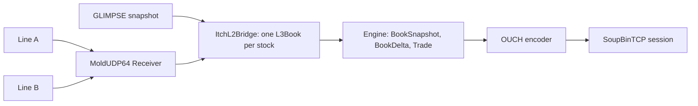

# Nasdaq protocol family: ITCH 5.0, MoldUDP64, GLIMPSE 5.0, SoupBinTCP, OUCH 4.2 / 5.0

The Nasdaq wire codecs and session layers live in `fastmm::codecs` (`itch`, `moldudp`, `soupbin`, `ouch42`, `ouch50`) and depend only on `fastmm::core`. Framers, decoders, encoders and session callbacks are `noexcept` and allocate nothing after construction.

| Protocol | Headers | Specification |
|---|---|---|
| TotalView-ITCH 5.0 | `include/fastmm/codecs/itch/` | `NQTVITCHspecification.pdf`, revision 2023-04-28 |
| MoldUDP64 1.00 | `include/fastmm/codecs/moldudp/` | `moldudp64.pdf`, 2024-08-02 |
| GLIMPSE 5.0 | `include/fastmm/codecs/itch/glimpse.hpp` | `NQGlimpseSpecification.pdf` |
| SoupBinTCP 3.00 / 4.00 / 4.10 | `include/fastmm/codecs/soupbin/` | `soupbintcp.pdf`, `SoupBinTCP 4.0.pdf`, `SoupBinTCP41.pdf` |
| OUCH 4.2 | `include/fastmm/codecs/ouch/ouch42.hpp` | `OUCH4.2.pdf`, October 2025 |
| OUCH 5.0 | `include/fastmm/codecs/ouch/ouch50.hpp` | `Ouch5.0.pdf`, October 2025 |

Shared field helpers (6-byte timestamps, price and share conversions, alpha and numeric fields) are in `include/fastmm/codecs/itch/nasdaq_fields.hpp` (`fastmm::codecs::nasdaq`).

How the `nasdaq_itch` venue chains them:

## Wire layouts

Every message is a `#pragma pack(1)` struct of big-endian fields (`be16_t`, `be32_t`, `be64_t` in `codec.hpp`), read and written through `get()` and `set()`. `static_assert`s pin the size and the offsets the code touches.

| Protocol | Direction | Message lengths, bytes |
|---|---|---|
| ITCH 5.0 | — | S 12, R 39, H 25, Y 20, L 26, V 35, W 12, K 28, J 35, h 21, A 36, F 40, E 31, C 36, X 23, D 19, U 35, P 44, Q 40, B 19, I 50, N 20, O 48 |
| OUCH 4.2 | inbound | O 49, U 47, X 19, M 20 |
| OUCH 4.2 | outbound | S 10, A 66, U 80, C 28, D 38, E 40, B 32, G 45, J 24, P 23, I 23, T 36, M 28 |
| OUCH 5.0 | inbound | O 45, U 38, X 9, M 10, C 17, D / E 9, Q 1 |
| OUCH 5.0 | outbound | S 10, A 62, U 66, C 18, D 32, E 34, B 36, J 29, P / I 13, T 30, M 18, R 14, X 25, G / K 17, Q 13 |

OUCH 5.0 lengths are the fixed part; `Appendage Length(2)` and TagValue options follow. S has no appendage. For C, D, B, J, P, I, T, M and Q the decoder accepts the message with or without Appendage Length.

## Prices, quantities, timestamps

| Field | Conversion |
|---|---|
| Price(4): ITCH, OUCH 4.2 | × 10 000 to the engine's 1e-8 `Price`; always exact |
| Price(8): OUCH 5.0 | × 10 000, range-checked |
| Price(8): ITCH MWCB levels | already 1e-8 |
| Engine price to Price(4) | refused (encoder returns 0) when negative, finer than 4 decimals or out of range |
| Shares | whole; OUCH enforces `< 1,000,000` and `<= $199,999.9900` |
| Timestamp | nanoseconds since midnight; `exch_ts = set_midnight() + timestamp` |
| `recv_ts` | the `rx_ts` argument |
| `venue_seq` | the value passed to `set_venue_seq()`: the MoldUDP64 or SoupBinTCP sequence |

The caller supplies midnight of the trading day in US/Eastern as Unix nanoseconds. `nasdaq::eastern_midnight()` computes it with US daylight-time rules; the `nasdaq_itch` venue rolls it at each Eastern midnight.

## ITCH 5.0

`ItchDecoder` (a `Decoder`) dispatches on the first byte:

| ITCH | Engine event |
|---|---|
| A, F Add Order | `OrderAddL3Msg` |
| E Order Executed | `OrderExecL3Msg`, `exec_price` 0 (at the order price) |
| C Order Executed With Price | `OrderExecL3Msg`, `exec_price` = Execution Price; `kNonPrintable` unless Printable is `Y` |
| X Order Cancel | `OrderCancelL3Msg`, `canceled_qty` = Cancelled Shares |
| D Order Delete | `OrderCancelL3Msg`, `canceled_qty` 0 (delete) |
| U Order Replace | `OrderReplaceL3Msg` |
| P Trade (non-displayable) | `TradeMsg` with `kNoAggressor`; Nasdaq sends B for every P |
| Q Cross Trade | `TradeMsg` with `kNoAggressor`; skipped when Shares is 0 |
| R Stock Directory | maps stock locate to `InstrumentId`; no event |
| S H Y L V W K J h B I N O | validated, ignored |

| Member | Does |
|---|---|
| `add_symbol()` | registers a symbol before the directory spin |
| `map_locate()` | maps a locate directly, for replay |
| `stats().unknown_locate` | counts messages for unmapped locates (a flat 65 536-entry table), which are ignored |
| `decode()` | writes into an `EventSink` |
| `decode_into()` | also takes a `ScratchSink` that holds the message's one event for in-place use |
| `ItchEncoder` | writes the same messages for simulation and replay; refuses values it cannot represent exactly |

## ITCH to L2 (`ItchL2Bridge`)

`include/fastmm/codecs/itch/itch_l2_bridge.hpp` keeps one `L3Book` per configured instrument and writes engine events to an `EventSink` ([ADR-0015](../../adr/0015-multicast-market-data.md)). Pass each message with its sequence number and the datagram's `DatagramStamp` to `on_itch_message()`, then call `end_datagram()`.

| Input | Effect |
|---|---|
| R, S (any locate) | R maps the locate of a symbol from `add_instrument()`; S is kept in `last_system_event()` |
| other types, unconfigured locate | skipped after the 11-byte header (`stats().skipped`) |
| A F E C X D U | applied to the `L3Book`; unknown or duplicate references count in `stats().book_errors`, refusals of a full book in `stats().capacity_errors` (the book leaves service) |
| E, C with Printable `Y` | `TradeMsg` at the resting price (E) or Execution Price (C), aggressor opposite the resting side, `trade_id` = Match Number |
| P, Q | `TradeMsg` from `ItchDecoder` |

| Call | Emits |
|---|---|
| (book incomplete) | nothing; the book is updated |
| `mark_complete(id)` | `BookSnapshotMsg` (`kSnapshot`) with the top `depth` levels a side (default 20); `ConnectionStateMsg{Live, channel 0}` once every book is complete |
| `mark_incomplete(reason)` | clears every book; `ConnectionStateMsg{Resyncing, channel 0}` |
| `end_datagram()` | at most one `BookDeltaMsg` per complete book |

A delta holds the top-`depth` levels that differ from the last emitted top, as absolute quantities (0 deletes). A level that enters or leaves the top is included, so the engine's book holds exactly the top `depth`. Changes below the emitted top of a full side emit nothing.

| Delta field | Value |
|---|---|
| `first_update_id`, `last_update_id` | sequences of the first and last message applied since the previous emission |
| `prev_update_id` | the previous emission's `last_update_id` |
| `venue_seq` | `last_update_id` |
| `t0_cycles`, `recv_ts` | from the datagram's stamp |
| `t1_delta` | taken after decode and the L3 update |

A delta the sink has no room for is counted in `stats().overflow` and sent with the next one.

### L3 book

`L3Book` (`core/book/l3_book.hpp`) takes `L3BookConfig{price_window_ticks, max_orders, max_overflow_levels}` and allocates everything in its constructor. The bridge uses ITCH's tick of 0.0001, so sub-penny prices stay exact.

| Part | Holds |
|---|---|
| Window | levels within `price_window_ticks` a side (rounded up to a power of two), indexed by tick; a ring, so a recentre moves only the levels that leave or enter |
| Overflow store | levels outside the window, such as stub quotes, sorted in blocks of 64 behind a sorted directory |

Each operation costs O(1) amortised. `clear()`, which every resync runs, costs the orders held, not the capacity.

The `nasdaq_itch` venue sizes the overflow store with `max_overflow_levels` (default 8192 a side; 0 disables it), about 192 bytes per level per book. A full store refuses an order with `OutOfWindow`, and the book leaves service until the next resync ([startup and recovery](../venues/nasdaq-itch.md#startup-and-recovery)). The most active stocks need up to about 3000 levels a side at the open; 1024 is not enough.

The window recentres when a touch has left it and the overflow store has taken about as many operations at that touch as the move costs:

| Touches | New window |
|---|---|
| less than a window apart | centred on their midpoint |
| further apart | stays on the touch it holds; on the bid when it holds neither |
| a touch that leaves and returns at once | unchanged |

`recentre_count()`, `recentre_failures()` (skipped because the overflow store was full) and `recentre_levels_moved()` count the moves. The venue reports their sums in the [status file](../status-file.md#multicast-feed) and as `fastmm_feed_book_recentres_total`.

Two tools in `bin/bench/` replay an ITCH 5.0 file in Nasdaq's sample format:

| Tool | Prints |
|---|---|
| `fastmm-bench-l3-itch FILE` | latency percentiles per message, recentres per book, book errors, the fullest overflow store; `--check` compares every touch with a `std::map` book; `--window`, `--max-orders`, `--max-overflow` set capacities; `--from 09:30` applies earlier messages untimed |
| `fastmm-bench-queue-truth FILE [--top K] [--hidden]` | scores the `l2_queue` (five conservatisms) and `l3_queue` models against what ITCH executed, per order and in markouts ([Backtesting](../../explanation/backtesting.md#the-queue-from-every-order)); 100 stocks take about 35 s |

## MoldUDP64

A MoldUDP64 feed is sent twice, on lines A and B. The network thread passes the first copy of each packet to the engine, so a packet lost on one line comes from the other. Binance USDⓈ-M applies the same rule to bookTicker streams over `md_ticker_conns` connections:

<video class="fastmm-video" autoplay loop muted playsinline preload="metadata" poster="../../../assets/anim/redundant-feeds.jpg" src="../../../assets/anim/redundant-feeds.mp4"></video>

| Function | Does |
|---|---|
| `parse_packet()` | validates a datagram: 20-byte header, exactly `count` length-prefixed blocks |
| `MessageFramer`, `MessageIterator` | walk the messages with their implied sequence numbers |
| `PacketBuilder`, `write_heartbeat()`, `write_end_of_session()`, `write_request()` | build packets |

`Receiver<Handler, Meta>` (a `SessionLayer`) delivers messages strictly in sequence to `Handler::on_message(seq, msg, meta)`, or `on_message(seq, msg)`. `on_packet(line, datagram, now_ns, meta)` takes one datagram of any line; `meta` reaches every message of that packet. `on_frame()` is line 0 at the latest time seen.

| Behaviour | Rule |
|---|---|
| Arbitration | the first copy of a sequence wins; later copies count as duplicates of their line |
| Line skew | each duplicate's delay behind the first copy, per line: `skew_last_ns`, `skew_max_ns`, `skew_sum_ns`, `skew_samples`; from the last 4 096 packet start sequences |
| Reorder buffer | packets ahead of the next sequence are held in `reorder_packets` slots and delivered when the sequence reaches them |
| Gap opens | a data packet beyond the next sequence, or a heartbeat or End of Session announcing a higher one |
| Gap declared | after `gap_timeout_ns` with the sequence on neither line, or at once when an ahead packet cannot be held (dropped, `reorder_overflow`) |
| Re-request (`can_request`) | a Request Packet via `Handler::send_request()` for the first hole, up to `max_request_count`; re-sent after `request_timeout_ns` |
| Next hole | requested once `gap_timeout_ns` old, or at once if it holds dropped packets |
| Gap given up | after `max_request_attempts` requests without progress, or any declared gap without `can_request`: `Handler::on_gap_unrecoverable(from_seq, count)`, then delivery resumes at the first held packet |
| End of Session | `Handler::on_end_of_session()` once every earlier message was delivered |
| New session id after End of Session | adopted from sequence 1 (or its first packet with `next_sequence = 0`) with `follow_session`; otherwise `session_mismatch` |

| `ReceiverConfig` | Default | Meaning |
|---|---|---|
| `session` | blank | blank: adopt the first packet's session |
| `next_sequence` | 0 | 0: start at the first packet received (live join) |
| `max_request_count` | 1024 | messages per Request Packet |
| `request_timeout_ns` | 250 ms | re-send an unanswered request |
| `max_request_attempts` | 4 | requests for one hole before giving up; 0: no limit |
| `gap_timeout_ns` | 2 ms | wait for the other line; size it from the measured skew; 0: declare at once |
| `reorder_packets` | 256 | packets held ahead of a gap |
| `max_packet_bytes` | 1472 | largest datagram that can be held |
| `can_request` | true | a re-request server exists |
| `follow_session` | false | adopt a new session after End of Session |

`Transmitter` keeps a fixed-capacity history, builds live packets up to `max_datagram` and answers Request Packets. `next_packet()` takes an optional message limit.

| `overwrite_oldest` | History |
|---|---|
| `true` | a ring bounded by `history_messages` and `history_bytes`; `oldest()` is the first sequence held; requests for evicted messages go unanswered |
| `false` | `publish()` fails once the history is full |

## GLIMPSE 5.0

GLIMPSE serves the current book over SoupBinTCP. After a login for sequence 1 it sends Stock Directory, Stock Trading Action and Add Order messages in ITCH 5.0 layouts, then End of Snapshot.

End of Snapshot is `'G' | Sequence Number(20, ASCII numeric)`: the ITCH sequence to continue from. `write_end_of_snapshot()` writes it right-aligned and space-padded; `parse_end_of_snapshot()` accepts space or zero padding.

`GlimpseClient<Writer, Handler>` wraps a SoupBinTCP `ClientSession<Writer>` and allocates nothing after construction:

| Member | Meaning |
|---|---|
| `GlimpseClient(writer, handler, GlimpseConfig)` | `GlimpseConfig::session` is the SoupBinTCP `ClientConfig`, its sequence forced to 1; `logout_after_snapshot` (default true) logs out after End of Snapshot |
| `login(now_ns)` | sends the Login Request; state `LoggingIn` |
| `on_bytes(span)` | consumes whole SoupBinTCP packets, returns the bytes consumed; a partial packet stays with the caller |
| `on_timer(now_ns)`, `on_disconnect()` | forwarded to the session; down before End of Snapshot leaves the client `Idle` with `close_reason()` |
| `state()`, `complete()`, `end_sequence()` | `Idle`, `LoggingIn`, `Receiving`, `Complete`; the End of Snapshot sequence |
| `Handler::on_snapshot_message(msg)` | each message before End of Snapshot, valid during the call |
| `Handler::on_snapshot_end(next_itch_seq)` | the sequence to continue from |

## SoupBinTCP

`SoupBinFramer` splits the TCP stream; `FrameView::kind` is the packet type and the payload excludes it. Builders and parsers cover `+ A J S U H Z L R O`.

| `ClientSession<Writer>` (a `SessionLayer`) | Does |
|---|---|
| `login(now)` | sends the Login Request with session and sequence; the 4.10 layout adds the heartbeat timeout |
| `on_frame()` | returns `false` for Sequenced (S) and server Unsequenced (U, 4.00+) data so the decoder sees them; counts S packets for the sequence |
| `on_timer()` | sends a heartbeat after `heartbeat_interval_ns` idle; drops the session after `server_timeout_ns` silent or `login_timeout_ns` unanswered |
| `login()` after `on_disconnect()` | resumes the accepted session at the next expected sequence |

`ServerSession<Writer, Handler>`, for tests and simulation:

* validates logins: username and password case-insensitive, session blank or matching;
* answers Accepted or Rejected and replays its sequenced history from the requested sequence;
* sends heartbeats and forwards client Unsequenced Data;
* closes on logout, login timeout or client timeout; the 4.10 Heartbeat Timeout overrides the configured one;
* starts a sequence past the end at the next message generated.

## OUCH 4.2

The Order Token (14 alphanumerics, unique per account and day) is `encode_cl_ord_id(cl_ord_id)`: `"fm"` and 12 lowercase hex digits. `decode_cl_ord_id()` reverses it.

`OuchEncoder` (an `Encoder`):

| Command | OUCH |
|---|---|
| New | Enter Order |
| Replace | Replace Order: existing token = `orig_cl_ord_id`, replacement = `cl_ord_id` |
| Cancel | Cancel Order, Shares 0 |
| GTC / DAY / IOC | Time in Force 99999 (system hours) / 99998 (market hours) / 0 |
| FOK | Time in Force 0, Minimum Quantity = Shares |
| PostOnly | Display `P` |
| Market | refused |

Firm, display, capacity, intermarket sweep, cross type, customer type and the replace time in force come from `EncoderConfig`.

`OuchDecoder` (a `Decoder`) keeps a fixed-capacity order table: client order id, reference number, leaves, cumulative quantity, side, instrument.

| OUCH outbound | Engine event |
|---|---|
| A Accepted | `OrderAckMsg`, venue order id = Order Reference Number; also `OrderExpiredMsg` when Order State is D |
| U Replaced | `OrderAckMsg` for the replacement token; cumulative quantity carries over |
| C Canceled, D AIQ Canceled | with no shares left: `OrderExpiredMsg` for reasons I (IOC) and T (timeout), else `OrderCancelAckMsg`; partial reductions update the table only |
| E Executed, G Executed with Reference Price | `OrderFillMsg`, exec id = Match Number, liquidity from the flag |
| J Rejected | `OrderRejectMsg` (`VenueReject`, `venue_code` = reason character) |
| I Cancel Reject | `OrderCancelRejectMsg` |
| S, B, P, T, M | no event; M updates leaves |

## OUCH 5.0

UserRefNum is a 4-byte number, unique per day and strictly increasing per port. `UserRefMap` assigns it from a counter and maps it to `ClientOrderId` both ways.

| Item | Rule |
|---|---|
| First UserRefNum | configurable; `set_next()` takes an Account Query Response's NextUserRefNum |
| Assigned | on New and on the replacement leg of Replace |
| Looked up | for Cancel and OrigUserRefNum |
| ClOrdID field | `encode_cl_ord_id(cl_ord_id)`, echoed in Accepted, Replaced, Rejected and Broken Trade |
| Decoder | resolves UserRefNum through the map, else the echoed ClOrdID; erases both on a done order |
| DAY and GTC | `0` (Day; OUCH 5.0 has no good-till-cancel) |
| IOC / FOK | `3` / `3` with the MinQty option |
| PostOnly | PostOnly option `P`; a non-blank firm adds the Firm option |
| Events | as OUCH 4.2; Rejected carries a 2-byte numeric reason |

A ClOrdID of `'T'` and 13 zero-padded digits is a sequence token: the MoldUDP64 sequence of the ITCH message that triggered the order (`put_seq_token()`, `parse_seq_token()`). `fastmm-sim-itch` times such orders wire to wire ([wire to wire](../sim-itch.md#wire-to-wire)). The decoder resolves them through `UserRefMap`.

The `host::` functions serve a simulated OUCH port:

| Function | Does |
|---|---|
| `host::parse_enter()`, `parse_replace()`, `parse_cancel()` | check an inbound message and convert it to engine units (`EnterView`: side, quantity, price, symbol, time in force, PostOnly, sequence token) |
| `host::` builders | write Accepted, Replaced, Canceled, Executed, Rejected, Cancel Reject, System Event, Account Query Response |

## Performance

Decoding an ITCH Add Order takes about 13 ns and arbitrating one A/B datagram about 15 ns; the full table is in [bench/full-results.md](../../../bench/full-results.md) ([method](../../explanation/benchmarks.md)).

## Unhandled fields

| Protocol | Not handled |
|---|---|
| ITCH | Attribution (F), Cross Type (Q) and the P Buy/Sell Indicator are dropped |
| MoldUDP64 | a new session adopted with `follow_session` is not reported; `on_message` sequences restart at 1 |
| SoupBinTCP | packet arrival time is that of the next `on_timer()` tick; a requested sequence of 0 starts at the next new message |
| OUCH | Replace Shares is sent as the command's quantity, though OUCH defines it as total including executions; Modify Order, Mass Cancel, Disable / Enable Order Entry and Account Query are laid out but not encoded |
