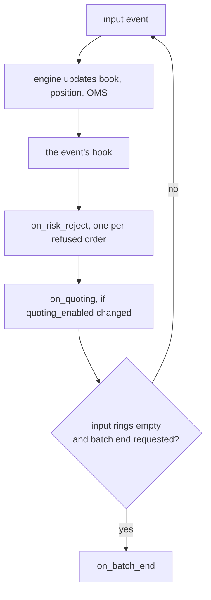

# Strategy API

The C++ interface a strategy implements and the engine context it calls. `#include "fastmm/strategy.hpp"` brings in everything; the headers are listed in [Public API](public-api.md).

Every code block on this page is compiled by [`tests/docs/strategy_api_doc_test.cpp`](../../tests/docs/strategy_api_doc_test.cpp) (ctest `docs.strategy_api`).

## Strategy class

A strategy is a default-constructible class with a static `name()` and a static `schema()`: the concept `StrategyLike`. `StrategyBase<Params>` provides `schema()` and the parameters.

| Member of `StrategyBase<Params>` | Meaning |
|---|---|
| `params() -> const Params&` | the current parameters, read-only |
| `configure(const ParamMap&) -> std::optional<std::string>` | applies `name -> value` strings and runs `validate()`; returns the first error and leaves the parameters unchanged. Startup only |
| `describe_params() -> std::string` | `name=value` pairs that parse back to the same values |

<!-- snippet: tests/docs/strategy_api_doc_test.cpp#verify -->
```cpp
static_assert(StrategyLike<AllHooks>);
static_assert(verify_strategy<AllHooks>());
```

`verify_strategy<S>()` checks every hook against stand-in context and book types, so a wrong hook fails in the strategy header.

## Hooks

Hooks are public member functions, and every hook is optional.

<!-- snippet: tests/docs/strategy_api_doc_test.cpp#hooks -->
```cpp
void on_start(auto& ctx) noexcept {
  hit(kStart);
  static_cast<void>(ctx.every(params().timer_ms, /*tag=*/7));
}
void on_stop(auto& /*ctx*/) noexcept { hit(kStop); }
void on_book(auto& ctx, InstrumentId id, const auto& book) noexcept {
  hit(kBook);
  if (!book.is_valid()) return ctx.pull_quotes(id);
  DesiredQuotes q;
  q.bid(book.best_bid().price, params().quote_qty);
  q.ask(book.best_ask().price, params().quote_qty);
  static_cast<void>(ctx.set_quotes(id, q));
}
void on_book_ticker(auto& /*ctx*/, InstrumentId /*id*/, const BookTickerMsg& /*m*/) noexcept {
  hit(kBookTicker);
}
void on_trade(auto& /*ctx*/, InstrumentId /*id*/, const TradeMsg& /*m*/) noexcept { hit(kTrade); }
void on_option_ticker(auto& /*ctx*/, InstrumentId /*id*/, const OptionTickerMsg& /*m*/) noexcept {
  hit(kOptionTicker);
}
void on_fill(auto& /*ctx*/, const Fill& /*fill*/) noexcept { hit(kFill); }
void on_order_update(auto& /*ctx*/, const OmsUpdate& /*u*/) noexcept { hit(kOrderUpdate); }
void on_timer(auto& ctx, TimerId /*id*/, std::uint64_t tag) noexcept {
  if (tag != 7) return;
  hit(kTimer);
  // Once: a price off the tick is refused by the engine's own check (on_risk_reject).
  if (count(kTimer) == 1)
    static_cast<void>(ctx.send(NewOrderRequest::limit(
        InstrumentId{0}, Side::Buy, Price::from_decimal("99.995").value(), params().quote_qty)));
}
void on_connection(auto& /*ctx*/, const ConnectionStateMsg& /*m*/) noexcept { hit(kConnection); }
void on_quoting(auto& /*ctx*/, bool /*enabled*/) noexcept { hit(kQuoting); }
void on_params(auto& /*ctx*/) noexcept { hit(kParams); }
void on_balance(auto& /*ctx*/, const BalanceMsg& /*m*/) noexcept { hit(kBalance); }
void on_perp_state(auto& /*ctx*/, InstrumentId /*id*/, const PerpStateMsg& /*m*/) noexcept {
  hit(kPerpState);
}
void on_risk_reject(auto& /*ctx*/, const RiskReject& r) noexcept {
  if (r.reason == RejectReason::InvalidTick && !r.replace) hit(kRiskReject);
}
```

| Hook | Called |
|---|---|
| `on_start(ctx)` | once, before the first event; `ctx.quoting_enabled()` is true in a dry run, whose orders stay on paper |
| `on_stop(ctx)` | once, when the engine finishes; shutdown's cancel-all pulls the quotes |
| `on_book(ctx, id, book)` | after a snapshot or delta is applied, the position marked and risk updated; the book may be invalid (empty or crossed) |
| `on_book_ticker(ctx, id, m)` | a top-of-book update without depth |
| `on_trade(ctx, id, m)` | a public trade |
| `on_option_ticker(ctx, id, m)` | an option's mark, implied volatilities and greeks ([Options](options.md)) |
| `on_fill(ctx, fill)` | one of our executions, after position and fees are updated, before that execution's `on_order_update` |
| `on_order_update(ctx, u)` | an OMS state change of one of our orders, including the end of a reconciliation |
| `on_timer(ctx, id, tag)` | a timer from `ctx.every` or `ctx.once` fired |
| `on_connection(ctx, m)` | a venue channel changed state; off `Live`, the venue's quotes are already pulled and, for market data, its books cleared |
| `on_quoting(ctx, enabled)` | `ctx.quoting_enabled()` changed ([on_quoting](#on_quoting)) |
| `on_params(ctx)` | a parameter update was applied and `params()` holds the new values ([Parameter updates](#parameter-updates)) |
| `on_balance(ctx, m)` | a venue reported one asset of the account; `ctx.balance` already holds it ([Balances](#balances)) |
| `on_perp_state(ctx, id, m)` | a derivative's mark, index or funding arrived; `ctx.mark` and `ctx.funding` already hold it ([Perpetuals](#perpetuals)) |
| `on_risk_reject(ctx, r)` | the engine's own risk check refused a new order or replace, and nothing was sent ([on_risk_reject](#on_risk_reject)) |
| `on_batch_end(ctx)` | once, after the events waiting when the strategy called `ctx.request_batch_end()` ([on_batch_end](#on_batch_end)) |

One input event runs through the hooks in this order:



| Rule | |
|---|---|
| Signature | hooks return `void`; `auto& ctx` and `template <class Ctx> void on_x(Ctx& ctx, ...)` are the same |
| `noexcept` | hooks run inside `noexcept` engine code; declare them `noexcept` |
| Instrument scope | `on_book`, `on_book_ticker`, `on_trade`, `on_option_ticker`, `on_perp_state` and `on_fill` fire only for instruments in the table, so `ctx.book(id)` and `ctx.instrument(id)` are valid in them |
| Every fill | `on_fill` also fires for late fills and for ids the OMS does not know; fills on instruments outside the table are counted in `EngineStats::unknown_instrument_fills` |
| Determinism | no blocking, no allocation per event, no input the engine does not see: system clock, `std::random_device`, files ([Determinism](../explanation/determinism.md)) |

### on_quoting

`set_quotes` is ignored while quoting is disabled. `on_quoting(ctx, enabled)` reports each change, so a strategy can requote as soon as quoting is back.

Quoting is disabled by an operator pull (`PullQuotes`), the kill switch, a reconciliation, or parameters older than `max_param_age_ms` ([Parameter updates](#parameter-updates)). A lost connection does not disable it; `on_connection` reports that. A dry run quotes, and its orders are acknowledged on paper.

- The engine compares `ctx.quoting_enabled()` before and after each event, fired timer and `on_start`, and calls the hook once all flags are final.
- At the end of a reconciliation the hook fires after the paused quotes are placed again, so a requote from it replaces them.
- It never fires from inside a context call: a kill switch tripped by `set_quotes` or `send` is reported after the calling hook returns.
- It does not fire for the initial state; `on_start` reads `ctx.quoting_enabled()`.

### on_batch_end

`ctx.request_batch_end()` from any hook asks for one `on_batch_end(ctx)` once the engine has handled the events waiting in its input rings. That is when the rings are empty or the step's `max_events_per_step` is used up.

Use it for work a burst would repeat per event. A strategy that requotes on each balance report marks the instruments in `on_balance` and requotes them once here.

- Several requests before the call make one call. A request from inside `on_batch_end` makes one more call, after the step's timers or at the next step.
- The engine journals each call, so a replay calls it after the same event.
- Orders sent from it carry the receive time (T0) of the event that asked last.
- `[engine] feed_budget_per_ring` sets how many events the engine takes from one input ring before the next ring's turn; 1 interleaves an account's order events with market data.

### on_risk_reject

An order the `[risk]` limits refuse is not sent. `send` and `replace` return the `RejectReason`; `set_quotes` returns true and the quote manager keeps the level for the next requote. The engine counts and logs the reject, and `on_risk_reject(ctx, r)` reports it.

| `RiskReject` field | Meaning |
|---|---|
| `instrument`, `side`, `type`, `price`, `qty` | the refused order |
| `reason` | the `RejectReason` |
| `user_tag` | the order's tag; a quote's tag is the `QuoteManager`'s |
| `replace`, `order` | whether it was a replace, and the id it would have changed (invalid for a new order) |
| `time` | engine time of the reject |

- Rejects are delivered after the calling hook returns, in the order they happened, together with `on_quoting`.
- An order refused again from inside `on_risk_reject` is reported in a further round, a few rounds at most. The queue holds 64 rejects per event; overflow is counted in `EngineStats::risk_reject_notices_dropped`.
- A strategy without the hook pays nothing: the queue is compiled out.
- An order the venue refused is not a risk reject: it arrives in `on_order_update` with `OrderState::Rejected`.

### Signature checks

The engine checks each hook name at compile time. A member with a hook's name whose call does not compile stops the build, one error per hook:

```text
error: static assertion failed: fastmm: on_trade has the wrong signature or is not public; expected void on_trade(auto& ctx, InstrumentId id, const TradeMsg& m)
```

| Case | Result |
|---|---|
| likely misspelling: `on_fills`, `on_trades`, `on_order_book`, `on_tick`, `on_bbo`, `on_order`, `on_execution`, `on_disconnect`, `onBook`, ... | warning `fastmm: on_fills is not a hook; did you mean on_fill?`, an error with `FASTMM_WERROR`; silence it with `static constexpr bool fastmm_allow_near_miss_names = true;` |
| a `final` class | only call-checked: a wrong signature is not called and not reported |
| a hook ambiguous across two bases | reported as a wrong signature |
| a hook with a deduced (`auto`) return type | must not be checked with `verify_strategy` |
| a private hook, also with `friend` | rejected |
| implicit argument conversions | accepted |

`Engine::start()` logs the implemented hooks: `strategy first_mm hooks: start book fill timer connection quoting`.

## Context

`ctx` is a `StrategyContext<Engine>`, a non-owning view of the engine.

<!-- snippet: tests/docs/strategy_api_doc_test.cpp#context -->
```cpp
// time and reference data
static_assert(std::same_as<decltype(lvalue<Ctx>().now()), Timestamp>);
static_assert(std::same_as<decltype(lvalue<Ctx>().instrument(InstrumentId{})), const Instrument&>);
static_assert(std::same_as<decltype(lvalue<Ctx>().instruments()), const InstrumentTable&>);
static_assert(std::same_as<decltype(lvalue<Ctx>().venue_name(VenueId{})), std::string_view>);
static_assert(std::same_as<decltype(lvalue<Ctx>().contains(InstrumentId{})), bool>);
// market data
static_assert(std::same_as<decltype(lvalue<Ctx>().book(InstrumentId{})), const Book&>);
static_assert(
    std::same_as<decltype(lvalue<Ctx>().own_qty(InstrumentId{}, Side::Buy, Price{})), Qty>);
static_assert(
    std::same_as<decltype(lvalue<Ctx>().own_qty(InstrumentId{}, Side::Buy, Price{}, Timestamp{})),
                 Qty>);
static_assert(std::same_as<decltype(lvalue<Ctx>().best_ex_self(InstrumentId{}, Side::Buy)), Level>);
// portfolio
static_assert(std::same_as<decltype(lvalue<Ctx>().position(InstrumentId{})), const Position&>);
static_assert(std::same_as<decltype(lvalue<Ctx>().portfolio()), Portfolio>);
// quoting
static_assert(
    std::same_as<decltype(lvalue<Ctx>().set_quotes(InstrumentId{}, DesiredQuotes{})), bool>);
static_assert(std::same_as<decltype(lvalue<Ctx>().pull_quotes(InstrumentId{})), void>);
static_assert(std::same_as<decltype(lvalue<Ctx>().pull_all_quotes()), void>);
static_assert(std::same_as<decltype(lvalue<Ctx>().working_quote(InstrumentId{}, Side::Buy, 0)),
                           const Order*>);
// direct orders
static_assert(std::same_as<decltype(lvalue<Ctx>().send(NewOrderRequest{})),
                           Result<ClientOrderId, RejectReason>>);
static_assert(
    std::same_as<decltype(lvalue<Ctx>().cancel(ClientOrderId{})), Result<void, RejectReason>>);
static_assert(std::same_as<decltype(lvalue<Ctx>().replace(ClientOrderId{}, Price{}, Qty{})),
                           Result<void, RejectReason>>);
static_assert(std::same_as<decltype(lvalue<Ctx>().order(ClientOrderId{})), const Order*>);
static_assert(std::same_as<decltype(lvalue<Ctx>().open_qty(InstrumentId{}, Side::Buy)), Qty>);
static_assert(std::same_as<decltype(lvalue<Ctx>().oms()), const Oms&>);
static_assert(
    std::same_as<decltype(lvalue<Ctx>().queue_ahead(ClientOrderId{})), std::optional<Qty>>);
static_assert(
    std::same_as<decltype(lvalue<Ctx>().order_times(ClientOrderId{})), const OrderTimes*>);
// timers
static_assert(std::same_as<decltype(lvalue<Ctx>().every(Duration{}, std::uint64_t{})), TimerId>);
static_assert(std::same_as<decltype(lvalue<Ctx>().once(Duration{}, std::uint64_t{})), TimerId>);
static_assert(std::same_as<decltype(lvalue<Ctx>().cancel_timer(TimerId{})), bool>);
// control
static_assert(std::same_as<decltype(lvalue<Ctx>().quoting_enabled()), bool>);
static_assert(std::same_as<decltype(lvalue<Ctx>().killed()), bool>);
static_assert(std::same_as<decltype(lvalue<Ctx>().venue_killed(VenueId{})), bool>);
static_assert(std::same_as<decltype(lvalue<Ctx>().request_stop()), void>);
static_assert(std::same_as<decltype(lvalue<Ctx>().trip_kill(KillReason::StrategyError)), void>);
// randomness (seeded from the configuration)
static_assert(std::same_as<decltype(lvalue<Ctx>().rng()), Xoshiro256ss&>);
```

| Method | Notes |
|---|---|
| `now()` | the engine clock of the current event; virtual time in backtests and replay |
| `instrument(id)`, `instruments()`, `contains(id)` | the instrument table; iterate `instruments()` for all of them |
| `venue_name(venue)` | the venue's `[venues.<name>]` name, which log lines print as `venue:symbol` |
| `book(id)` | the instrument's L2 book ([Book](#book)) |
| `position(id)` | signed `qty` in base units, average price, realised PnL with funding, and fees, in the settlement currency |
| `portfolio()` | `realized`, `unrealized`, `fees` and `net` over all instruments, in the `[accounting]` reporting currency when set; a loop, not for every event |
| `set_quotes(id, q)` | the desired ladder; the quote manager sends the difference. False when ignored: quoting disabled or instrument not in the table |
| `pull_quotes(id)`, `pull_all_quotes()` | cancel the quotes of one or every instrument |
| `working_quote(id, side, level)` | the open order in a quote slot, level 0 nearest the mid, or `nullptr` |
| `send(req)` | a direct order, risk-checked and journaled; fails with the `RejectReason` of risk, the OMS or the kill switch |
| `cancel(id)`, `replace(id, px, qty)` | direct order management; cancels are always allowed |
| `order(id)` | an open order, or `nullptr` once terminal; valid until the next context call |
| `open_qty(id, side)` | unfilled quantity of our open orders on one side, quotes included |
| `oms()` | read-only order management state |
| `every(period, tag)`, `once(delay, tag)` | timers in engine time, journaled; `on_timer` gets the id and tag. Invalid id once 1016 timers exist: the wheel keeps 8 slots for the engine |
| `cancel_timer(id)` | false when the timer no longer exists |
| `watch(id, on)` | `watch(id, false)` stops `on_book`, `on_book_ticker`, `on_trade` and `on_option_ticker` for an instrument; its book stays current |
| `quiet_book(id, lo, hi)`, `quiet_book(id)` | calls `on_book` only once the mid reaches `lo` or `hi` or the book turns invalid; the one-argument form ends it |
| `quoting_enabled()`, `killed()`, `venue_killed(venue)` | quoting state, the global kill switch, one venue's kill switch |
| `note_quote(id, side, reason, budget = {})` | why the strategy quotes a side as it does, up to 23 bytes, and its budget, for `fastmm-top`'s quote table ([Monitoring](../how-to/operations/monitor-with-fastmm-top.md)) |
| `metric(name, value)` | publishes a named number in the status file, `fastmm-top` and `fastmm_strategy_metric`; first 32 names, 23 bytes each |
| `request_stop()` | sets the stop flag: a backtest ends after the current step; replay always drains the journal |
| `trip_kill(reason)` | trips the global kill switch: quoting stops and every working order is cancelled |
| `rng()` | a `Xoshiro256ss` seeded from `[engine] rng_seed`, identical in replay |
| `own_qty`, `best_ex_self`, `queue_ahead`, `order_times` | our own orders as the market sees them ([Execution view](#execution-view)) |

- `send` returns `InvalidTag` when `user_tag` lies in the quote manager's range.
- A venue whose kill switch is engaged refuses new orders, and `set_quotes` ignores its instruments.
- `watch` and `quiet_book` give the same result and run faster in a sweep ([Many runs in one pass](../explanation/backtesting.md#many-runs-in-one-pass)).
- `set_quotes` applies hysteresis (`[engine] min_requote_ticks`, `min_requote_interval_ms`), skips orders awaiting a venue response, and replaces where the venue supports it.

A direct order returns a `Result`:

```cpp
auto id = ctx.send(NewOrderRequest::limit(inst.id, Side::Buy, px, qty).post_only());
if (!id) return FASTMM_LOG_WARN("order refused: {}", id.error());  // e.g. RejectReason::MaxPosition
```

### Fees, risk headroom and venue health

<!-- snippet: tests/docs/strategy_api_doc_test.cpp#venue_state -->
```cpp
static_assert(std::same_as<decltype(lvalue<Ctx>().fees(InstrumentId{})), const FeeRates&>);
static_assert(std::same_as<decltype(lvalue<Ctx>().risk_headroom(InstrumentId{})), RiskHeadroom>);
static_assert(std::same_as<decltype(lvalue<Ctx>().venue_health(VenueId{})), VenueHealthView>);
static_assert(std::same_as<decltype(lvalue<Ctx>().order_budget(VenueId{})), OrderBudget>);
```

| Method | Returns | Journaled |
|---|---|---|
| `fees(id)` | `FeeRates` | yes |
| `risk_headroom(id)` | `RiskHeadroom`: what each `[risk]` limit still admits on the instrument | yes |
| `venue_health(venue)` | `VenueHealthView`: feed lag and order round trip | yes |
| `order_budget(venue)` | `OrderBudget`: the local rate limiter and the venue's own order counts | only `local_tokens` |

`fees(id)` is the instrument's `maker_bps` / `taker_bps`, else its venue's `[venues.<x>.fees]`. With `fetch_fees` it is the account's own rates ([Binance Spot](venues/binance-spot.md#fee-rates)). A backtest charges these; a live venue reports each fill's commission itself.

| `FeeRates` | Meaning |
|---|---|
| `maker_cbps`, `taker_cbps` | rates in centi-bps (1 cbps = 0.01 bps); positive is a fee, negative a rebate |
| `maker_bps()`, `taker_bps()` | the same in bps |
| `fee(notional, liquidity)` | the fee on a notional |

`risk_headroom(id)` uses the inputs the next risk check uses: an order of exactly a room passes, one lot more is refused. A limit that is off reads `RiskHeadroom::kUnlimited` or the type's `max()`. Notionals are in the reporting currency with `[accounting]`. `fastmm-gateway`'s account guards are not included.

| `RiskHeadroom` field | Room left under |
|---|---|
| `order_tokens` | the rate limiter, `orders_per_sec` |
| `open_orders` | `max_open_orders` on the instrument |
| `max_order_qty`, `max_order_notional` | the per-order limits |
| `buy_qty`, `sell_qty` | `max_position`, with that side's open orders counted, rounded down to the lot |
| `underlying_buy_qty`, `underlying_sell_qty` | `[risk.underlying]` `max_net` over the underlying's instruments, in this instrument's contracts; 0 while an inverse contract of it has no mark |
| `gross_notional` | the gross notional cap |
| `net_buy_notional`, `net_sell_notional` | the net exposure an order may open |
| `exposure_buy_notional`, `exposure_sell_notional` | those caps as one order's notional here, in the settlement currency; see below |
| `loss_budget` | `max_loss` plus net PnL; the kill switch trips at 0 |
| `balance_buy_qty`, `balance_sell_qty` | `balance_room` at the book's mid ([Balances](#balances)) |

On the side that reduces the position, `exposure_*_notional` adds the close at the mid. While the currency's rate is unknown that close is all that is left, and the other side reads 0.

| `VenueHealthView` field | Meaning |
|---|---|
| `feed_lag` | `recv_ts - exch_ts` of the venue's latest market-data message with a venue time |
| `feed_lag_base`, `feed_lag_excess` | the minimum lag over the last 8 s, and the lag above it |
| `ack_rtt`, `ack_rtt_smoothed` | engine time from sending a new order to its first ack; smoothed as `srtt += (rtt - srtt) / 8` |
| `md_updated`, `ack_updated`, sample counts | when each was last sampled |
| `gate_engagements`, `gated` | the [feed-lag gate](../explanation/risk-model.md#feed-lag-gate); while it holds a venue, `set_quotes` on its instruments returns false |

All fields are zero before the first sample. `venue_health` costs one lookup; `risk_headroom` costs a risk check.

| `OrderBudget` field | Meaning |
|---|---|
| `local_tokens` | orders the `[risk] orders_per_sec` bucket admits now; `kUnlimited` with the limit off |
| `local_wait_ns` | time until the bucket admits the next order, 0 if it admits one now; a strategy refused `RateLimit` waits this long |
| `orders_10s`, `orders_1m`, `orders_1d` | the venue's order counts per 10 s, minute and day: its last report plus the orders sent since |
| `weight` | request weight over the venue's shortest window: 6000 a minute on Binance Spot, 2400 on USDⓈ-M |
| `venue_paused` | the connector sends nothing: a 429 `Retry-After` or a 418 |
| `venue_known` | the connector has published counts |
| `orders_remaining()` | the least of the windows |

Each window is a `RateWindow`: `window_ms`, `used`, `limit`, `cap`, `known()`, `remaining()`. `cap` is where the connector stops sending, 90 % of `limit`, and `remaining()` counts up to it.

The venue fields come from the connector's thread and are not journaled. A backtest, a replay and a strategy attached to `fastmm-gateway` see `venue_known == false` and every window unlimited.

### Balances

<!-- snippet: tests/docs/strategy_api_doc_test.cpp#balances -->
```cpp
static_assert(std::same_as<decltype(lvalue<Ctx>().balance(VenueId{}, "USDT")), Balance>);
static_assert(std::same_as<decltype(lvalue<Ctx>().margin(VenueId{})), Margin>);
static_assert(
    std::same_as<decltype(lvalue<Ctx>().balance_room(InstrumentId{}, Side::Buy, Price{})), Qty>);
static_assert(std::same_as<decltype(Balance::free), Notional>);
static_assert(std::same_as<decltype(Balance::known), bool>);
static_assert(std::same_as<decltype(Margin::available), Notional>);
static_assert(std::same_as<decltype(lvalue<Ctx>().balances_live()), bool>);
```

| Method | Returns |
|---|---|
| `balance(venue, asset)` | `Balance` of one asset, amounts in the asset |
| `margin(venue)` | `Margin`: `available`, `initial`, `maintenance`, `equity`, `wallet`, `asset` |
| `balance_room(id, side, px)` | the largest quantity of `id` the balance covers at `px`, rounded down to the lot; `Qty::max()` until the venue reports that balance |
| `balances_live()` | a venue has reported balances; before that nothing is estimated or checked |

| `Balance` field | Meaning |
|---|---|
| `free`, `locked`, `total` | the venue's last report, moved by this engine's orders and fills since ([Balance check](../explanation/risk-model.md#balance-check)) |
| `equity`, `maintenance` | as reported |
| `as_of` | the report's venue time |
| `known` | false until the venue reports the asset, and for an asset no instrument of the venue uses |

- `margin` is the venue's account-wide margin where it reports one: `account` is true, usually valued in USD. Otherwise it is the settlement asset of the venue's first derivative.
- `balance_room` counts a spot buy's quote with the taker fee, a spot sell's base and a derivative's initial margin. This instrument's open orders on that side do not count as room.

### Account pools

Several accounts of one exchange behind one venue: `[venues.<x>] pool_of` ([Account pools](configuration.md#account-pools)). Instruments, books, tickers and positions are the primary's. Each member has its own `balance()`, `margin()` and `order_budget()` under its own venue id.

<!-- snippet: tests/docs/strategy_api_doc_test.cpp#pool -->
```cpp
static_assert(std::same_as<decltype(lvalue<Ctx>().pool(VenueId{})), PoolMembers>);
static_assert(std::same_as<decltype(lvalue<Ctx>().pool_primary(VenueId{})), VenueId>);
static_assert(std::same_as<decltype(lvalue<Ctx>().account_usable(VenueId{})), bool>);
static_assert(std::same_as<
              decltype(lvalue<Ctx>().balance_room(InstrumentId{}, Side::Buy, Price{}, VenueId{})),
              Qty>);
static_assert(std::same_as<decltype(lvalue<const PoolMembers>().size()), std::size_t>);
static_assert(std::same_as<decltype(lvalue<const PoolMembers>()[0]), VenueId>);
static_assert(std::same_as<decltype(NewOrderRequest::account), VenueId>);
```

| Method | Returns |
|---|---|
| `pool(primary)` | `PoolMembers`, primary first: `size()`, `operator[]`, `contains(venue)`, iterable; the venue alone without a pool |
| `pool_primary(venue)` | the venue whose instruments `venue` takes orders for: its primary, or itself |
| `account_usable(venue)` | automatic routing would send to it now: order link live, kill switch not engaged |
| `balance_room(id, side, px, account)` | `balance_room` on one account of the pool |

The three-argument `balance_room` on a pool is what one usable account can hold:

- the largest room over the members, a sell's free base or a buy's free quote at the price,
- plus that member's own open orders on the side,
- less `open_qty(id, side)` over every account, never below zero.

`fit_to_balance` therefore cuts a ladder to what one account covers. A quote resting on one account is not resized by another's balance.

An order goes to one account and stays there. `Order::venue`, `OmsUpdate` and `Fill` (`msg->hdr.venue`) and the store's rows carry the member's id; `cancel` and `replace` follow it.

`NewOrderRequest::account`, or `.account(venue)` on the builder, names the account. It must be the primary or a member, else `send` fails with `InvalidAccount`. Without one the engine picks:

1. Candidates: usable members whose free quote covers a spot buy's notional, or whose free base covers a spot sell. Every usable member for a derivative.
2. Skip members whose connector is paused or has an order window at its `cap`.
3. Take the one with most of the 10 s window left (`order_budget(member).orders_10s.remaining()`), then of the daily window.
4. Ties take turns, starting after the account the last automatic choice went to.
5. No member covers the order: it goes to the primary, which refuses it as the venue does.

- Orders sent to an account since its connector last published count against it, so one burst spreads over the pool.
- `send` refuses with `RateLimit`, without reaching the connector, an order whose account has a window at its cap or a paused connector.
- Cancels count in no order window.
- A member with its order link down or kill switch engaged gets no new orders; a kill of the primary stops the pool.
- `set_quotes` routes the same way, one order at a time.
- A backtest without window limits knows no budget and sends what the balances allow to the primary.

### Perpetuals

<!-- snippet: tests/docs/strategy_api_doc_test.cpp#perps -->
```cpp
static_assert(std::same_as<decltype(lvalue<Ctx>().mark(InstrumentId{})), RefPrice>);
static_assert(std::same_as<decltype(lvalue<Ctx>().index(InstrumentId{})), RefPrice>);
static_assert(std::same_as<decltype(lvalue<Ctx>().funding(InstrumentId{})), FundingView>);
static_assert(std::same_as<decltype(lvalue<Ctx>().perp_state(InstrumentId{})), const PerpRow&>);
static_assert(std::same_as<decltype(RefPrice::price), Price>);
static_assert(std::same_as<decltype(RefPrice::stale), bool>);
static_assert(std::same_as<decltype(FundingView::rate), double>);
static_assert(std::same_as<decltype(FundingView::interval), Duration>);
static_assert(std::same_as<decltype(lvalue<const FundingView>().over(Duration{})), double>);
```

| Method | Returns |
|---|---|
| `mark(id)`, `index(id)` | `RefPrice` of a derivative ([venues](venues/connector-behaviour.md#mark-index-and-funding)) |
| `funding(id)` | `FundingView` |
| `perp_state(id)` | `const PerpRow&`: every field as last reported, open interest included, with arrival times and no staleness applied |

| `RefPrice` field | Meaning |
|---|---|
| `price` | the venue's mark or index price |
| `at` | engine time it arrived |
| `stale` | older than `[accounting] stale_mark_ms`, or never reported |
| `usable()` | reported and not stale |

| `FundingView` field | Meaning |
|---|---|
| `rate` | per `interval`, a decimal; positive means longs pay shorts |
| `interval` | the funding period |
| `next` | venue time of the next payment; zero when funding is continuous |
| `at`, `stale`, `usable()` | as for `RefPrice`, against `stale_funding_ms` |
| `over(d)` | the rate over a holding time `d`: `rate * d / interval` |

- `PerpStateMsg::fields` names what a message carries; a venue with separate channels (OKX) sends one message per channel and the table keeps the rest.
- With `[accounting] mark = "venue"`, the default, a position with a fresh mark is valued at it ([Valuation](../explanation/risk-model.md#valuation-at-the-venue-mark)); `on_book` then no longer moves its unrealised PnL.
- `fit_to_balance(ctx, id, inst, q)` in `strategies/quoting.hpp` cuts a `DesiredQuotes` ladder to what the balance covers. The side's resting orders count as room, and a level under the lot, `min_qty` or `min_notional` is dropped.

## Execution view

Our own orders as the venue's feed shows them, derived from journaled order events and market data, so a replay reproduces them.

| Method | Returns |
|---|---|
| `own_qty(id, side, px)`, `own_qty(id, side, px, at)` | our resting quantity the feed shows at `px`, as of the book's last update or venue time `at`; 0 in the simulator |
| `best_ex_self(id, side)` | the best `Level` on one side with `own_qty` taken out; `Level{}` when none is left |
| `queue_ahead(order_id)` | `std::optional<Qty>`: the estimated quantity ahead of an open order at its price; `nullopt` before its ack and once terminal |
| `order_times(order_id)` | `const OrderTimes*` of an open order, `nullptr` once terminal |

- `own_qty` counts an order from its ack's venue time to its end's, less its fills. The end is a cancel ack, last fill, expiry or a reconciliation that drops it.
- With whole-millisecond venue times, an order counts to the end of that millisecond. A depth update stamped before our cancel still includes it.
- `at` is typically a `BookTicker`'s `hdr.exch_ts`. `best_ex_self` skips a level that was only ours.

| `OrderTimes` field | Meaning |
|---|---|
| `sent` | engine clock at send |
| `venue_ack` | the ack's `exch_ts`, whole ms on Binance; 0 when the venue gives none |
| `local_ack` | the ack's `recv_ts` |

After a replace they describe the replacement from its ack on. `OmsUpdate::times` carries them in `on_order_update`, the terminal update included, and `Fill::update` in `on_fill`.

Whether a venue's feed shows our orders is `own_in_feed(venue)`:

| Transport | Feed shows our orders |
|---|---|
| `LiveTransport` | yes |
| replay of a live journal, one with a TSC calibration | yes |
| backtest with `[backtest] own_orders_in_feed` | yes: the simulated venue sends our quantity as `OwnLevels` |
| other backtests | no |

### Queue position

`queue_ahead` runs the `l2_queue` fill model's [queue model](../../include/fastmm/core/queue_model.hpp) on the market data the strategy sees. Its conservatism is `[engine] queue_conservatism`, or `[backtest] queue_conservatism` in a backtest.

| Event | Quantity ahead |
|---|---|
| ack | the displayed quantity at the price less `own_qty`, less what trades since took from the level |
| ack at the touch of a newer book ticker | the touch's quantity less ours; 0 for a price better than that touch |
| depth delta at the price | a shrink from `old` to `new` takes `(old - new) * ahead / old * (1 - conservatism)`, `old` net of trades since the last update |
| level removed | 0 |
| snapshot | capped at the level |
| trade at the price | consumed first |
| trade through the price | 0, and the order fills the print's quantity |
| book ticker newer than the depth | 0 for an order better than its touch; at most the touch's quantity less ours at the touch |
| replace ack | kept at the same price and no more than the leaves; otherwise as for an ack |

- One print is shared by our orders on its side in price priority, best for the aggressor first. Each gets what the better ones left, after our maker fills at the print's venue time.
- "Newer" compares venue update ids when both messages carry one, else venue times.
- A level showing less than we rest at its price was published before our order arrived; all of it counts as others' quantity.
- Tracking starts at the first `queue_ahead` call. An order already resting then starts at the back of its level. Call it in `on_start` to cover every order from its ack.
- With `fill_model = "l2_queue"` and no latency the value equals the fill model's ([`tests/sim/exec_view_test.cpp`](../../tests/sim/exec_view_test.cpp)). With latency the simulated venue sees the market before the strategy does.
- A replay handles events in arrival order, `fastmm-data fill-check` in venue-time order, so the two can differ.

## Hedge executor

`HedgeExecutor` (`strategies/hedge_executor.hpp`) is a member a strategy owns. It hedges the positions of source instruments with IOC orders on hedge instruments, fails over between them and de-risks ([Hedge with HedgeExecutor](../how-to/strategies/hedge-executor.md)).

<!-- snippet: tests/docs/strategy_api_doc_test.cpp#hedge -->
```cpp
static_assert(std::same_as<decltype(lvalue<HedgeExecutor>().add_source(InstrumentId{})), bool>);
static_assert(
    std::same_as<decltype(lvalue<HedgeExecutor>().add_hedge(InstrumentId{}, Ratio{})), bool>);
static_assert(
    std::same_as<decltype(lvalue<HedgeExecutor>().start(lvalue<Ctx>(), HedgeExecutor::Config{})),
                 bool>);
static_assert(std::same_as<decltype(lvalue<HedgeExecutor>().on_fill(lvalue<Ctx>(), Fill{})), bool>);
static_assert(
    std::same_as<decltype(lvalue<HedgeExecutor>().on_order_update(lvalue<Ctx>(), OmsUpdate{})),
                 bool>);
static_assert(
    std::same_as<decltype(lvalue<const HedgeExecutor>().residual(lvalue<const Ctx>())), Qty>);
static_assert(
    std::same_as<decltype(lvalue<const HedgeExecutor>().can_hedge(lvalue<const Ctx>())), bool>);
static_assert(std::same_as<decltype(lvalue<const HedgeExecutor>().status(lvalue<const Ctx>())),
                           HedgeExecutor::Status>);
```

| Method | Does |
|---|---|
| `reset()`, `add_source(id)`, `add_hedge(id, tolerance)` | name the legs, at most 4 of each, hedges in order of preference; false when full |
| `start(ctx, config)` | checks the legs (configured, linear, each once) and starts; false and logged otherwise |
| `set_config(config)`, `set_tolerance(i, tolerance)` | new parameters |
| `set_target(qty)` | a new net target in base units |
| `restart()` | clears a halt |
| `on_fill`, `on_order_update`, `on_book`, `on_timer`, `on_connection`, `on_balance`, `update` | the strategy's hooks forwarded; the `bool` ones return whether the event concerned a leg or its orders |
| `residual(ctx)` | sources plus hedges minus the target, base units |
| `can_hedge(ctx)` | some hedge instrument can take a hedge now and hedging is not halted |
| `why(ctx, i, now)` | the `Reason` hedge `i` is not usable: `Down`, `Killed`, `NoBook`, `Stale`, `Gated`, `Benched`, or `Usable` |
| `held()`, `halted()`, `derisking()`, `state()`, `status(ctx)`, `stats()` | monitoring ([Monitor it](../how-to/strategies/hedge-executor.md#monitor-it)) |
| `hedge_order(inst, residual, bid, ask, tolerance, tag)` | static: the IOC that brings `residual` towards zero on `inst`, or none under its lot, `min_qty` or `min_notional` |

## Book

`on_book` receives the engine's `L2Book`. Any type modelling `BookView` has the same read API.

<!-- snippet: tests/docs/strategy_api_doc_test.cpp#book -->
```cpp
static_assert(BookView<Book>);  // best_bid(), best_ask(), mid(), spread(), level(side, i), ...
static_assert(std::same_as<decltype(lvalue<const Book>().best_bid()), Level>);
static_assert(std::same_as<decltype(lvalue<const Book>().mid()), Price>);
static_assert(std::same_as<decltype(lvalue<const Book>().is_valid()), bool>);
```

| Method | Meaning |
|---|---|
| `best_bid()`, `best_ask()` | the touch as `Level{price, qty}`; zero when the side is empty |
| `mid()`, `spread()` | `(bid + ask) / 2` truncated, `ask - bid` |
| `level(side, i)`, `depth(side)`, `top<N>(side)` | levels from the touch outwards |
| `qty_at_or_better(side, px)`, `price_for_qty(side, qty)` | depth queries |
| `is_valid()` | both sides present and not crossed |
| `seq()`, `last_update()` | venue sequence number and venue time of the last update; receive time without a venue time |

## Fill

`Fill` is built on the engine's stack; `update` and `msg` are valid only during the call.

<!-- snippet: tests/docs/strategy_api_doc_test.cpp#fill -->
```cpp
static_assert(std::same_as<decltype(Fill::instrument), InstrumentId>);
static_assert(std::same_as<decltype(Fill::side), Side>);
static_assert(std::same_as<decltype(Fill::price), Price>);
static_assert(std::same_as<decltype(Fill::qty), Qty>);
static_assert(std::same_as<decltype(Fill::position_delta), Qty>);
static_assert(std::same_as<decltype(Fill::fee), Notional>);
static_assert(std::same_as<decltype(Fill::fee_converted), bool>);
static_assert(std::same_as<decltype(Fill::liquidity), Liquidity>);
static_assert(std::same_as<decltype(Fill::known), bool>);
static_assert(std::same_as<decltype(Fill::late), bool>);
static_assert(std::same_as<decltype(Fill::order_done), bool>);
static_assert(std::same_as<decltype(Fill::update), const OmsUpdate*>);
static_assert(std::same_as<decltype(Fill::msg), const OrderFillMsg*>);
```

| Field | Meaning |
|---|---|
| `instrument`, `side` | the order's, else the fill message's |
| `price`, `qty` | this execution |
| `position_delta` | signed change of the position; differs from `qty` when the commission is charged in the base asset |
| `fee` | fee in the settlement currency as booked |
| `fee_converted` | false when the commission was in a third asset, such as BNB, and not booked |
| `liquidity` | `Maker`, `Taker` or `Unknown` |
| `known` | the id matched an order; `update->order` holds its snapshot |
| `late` | the order was already terminal when the fill arrived; its snapshot has id, instrument, side, state and filled quantity |
| `order_done` | the order reached a terminal state with this fill |
| `update`, `msg` | the OMS update, non-null when `known`, and the raw `OrderFillMsg` |

## Messages

Hooks receive fixed-size, trivially copyable structs from `core/messages.hpp`.

<!-- snippet: tests/docs/strategy_api_doc_test.cpp#messages -->
```cpp
static_assert(std::same_as<decltype(TradeMsg::price), Price>);
static_assert(std::same_as<decltype(TradeMsg::qty), Qty>);
static_assert(std::same_as<decltype(TradeMsg::aggressor), Side>);
static_assert(std::same_as<decltype(TradeMsg::trade_id), std::uint64_t>);
static_assert(
    std::same_as<decltype(std::declval<const TradeMsg&>().parties()), const TradeParties*>);
static_assert(std::same_as<decltype(TradeParties::buyer), PartyId>);
static_assert(std::same_as<decltype(TradeParties::seller), PartyId>);
static_assert(std::same_as<decltype(PartyId::kind), PartyIdKind>);
static_assert(std::same_as<decltype(BookTickerMsg::bid_px), Price>);
static_assert(std::same_as<decltype(BookTickerMsg::bid_qty), Qty>);
static_assert(std::same_as<decltype(BookTickerMsg::ask_px), Price>);
static_assert(std::same_as<decltype(BookTickerMsg::ask_qty), Qty>);
static_assert(std::same_as<decltype(OptionTickerMsg::mark_price), Price>);
static_assert(std::same_as<decltype(OptionTickerMsg::underlying_price), Price>);
static_assert(std::same_as<decltype(OptionTickerMsg::mark_iv), double>);
static_assert(std::same_as<decltype(OptionTickerMsg::delta), double>);
static_assert(std::same_as<decltype(ConnectionStateMsg::state), ConnState>);
static_assert(std::same_as<decltype(ConnectionStateMsg::channel), std::uint8_t>);
static_assert(std::same_as<decltype(EventHeader::instrument), InstrumentId>);
static_assert(std::same_as<decltype(EventHeader::venue), VenueId>);
static_assert(std::same_as<decltype(EventHeader::recv_ts), Timestamp>);
static_assert(std::same_as<decltype(EventHeader::exch_ts), Timestamp>);
static_assert(std::same_as<decltype(OmsUpdate::order), Order>);
static_assert(std::same_as<decltype(OmsUpdate::prev), OrderState>);
static_assert(std::same_as<decltype(OmsUpdate::terminal), bool>);
static_assert(std::same_as<decltype(BalanceMsg::free), Notional>);
static_assert(std::same_as<decltype(BalanceMsg::asset), FixedString<8>>);
static_assert(std::same_as<decltype(PerpStateMsg::mark_price), Price>);
static_assert(std::same_as<decltype(PerpStateMsg::funding_rate), double>);
static_assert(std::same_as<decltype(PerpStateMsg::next_funding), Timestamp>);
static_assert(std::same_as<decltype(PerpStateMsg::fields), std::uint8_t>);
```

| Message | Notes |
|---|---|
| `EventHeader` | starts every message: `type`, `venue`, `instrument`, `exch_ts` (venue event time), `recv_ts` (receive time), `seq` and flags |
| `TradeMsg` | `aggressor` is the taker's side |
| `TradeMsg::parties()` | who bought and who sold where the venue publishes it, else null; see below |
| `OptionTickerMsg` | `mark_price` in the instrument's price unit; `underlying_price` and `index_price` in the underlying's quote currency; IVs annualised decimals (0.312 is 31.2 %); the venue's greeks; NaN for a field not sent |
| `ConnectionStateMsg` | `state`: `Disconnected`, `Connecting`, `Live`, `Stale`, `Resyncing` or `Dead`; `channel` 0 market data, 1 order and user stream; `reason_code` venue-specific |
| `OmsUpdate` | `order` (snapshot after the transition), `prev` (the previous state), and the flags `known`, `changed`, `terminal` |
| `BalanceMsg` | one asset of a venue account as reported, absolute amounts in `asset` at `exch_ts`; see below |

Trade parties:

| Venue | `PartyIdKind` | Read with |
|---|---|---|
| Hyperliquid | `Address`, both wallet addresses | `raw()`, 20 bytes |
| Lighter | `Account`, both account indexes | `account()` |

A trade with parties is 192 bytes (`hdr.len`): the `TradeParties` follow the 128-byte message. A copied `TradeMsg` does not include them, so copy `*m.parties()`.

| `BalanceMsg` field | Spot | Derivative |
|---|---|---|
| `free` | free | available margin |
| `locked` | locked | initial margin in use |
| `total` | total | wallet balance |
| `equity` | total | wallet plus unrealised PnL |
| `maintenance` | 0 | maintenance margin |

| `BalanceMsg` flag | Meaning |
|---|---|
| `kSnapshot` | part of a full snapshot |
| `kSnapshotEnd` | the snapshot's last message; an asset it did not name holds nothing |
| `kAccount` | the account-wide margin |

## Parameters

<!-- snippet: tests/docs/strategy_api_doc_test.cpp#params -->
```cpp
struct AllHooksParams {
  FASTMM_PARAMS(AllHooksParams)
  FASTMM_PARAM(int, levels, 1, 1, 8, "quote levels per side")
  FASTMM_PARAM(double, gamma, 0.1, 0.0, 10.0, "risk aversion")
  FASTMM_PARAM(bool, hedge, false, false, true, "hedge fills")
  FASTMM_PARAM(Qty, quote_qty, 0.001_qty, 0_qty, 1000_qty, "quantity per side")
  FASTMM_PARAM_BPS(half_spread_bps, 5_bps, 0_bps, 1000_bps, "half spread, bps")
  FASTMM_PARAM_MS(timer_ms, milliseconds(100), milliseconds(1), milliseconds(60000), "timer, ms")

  // Optional: runs after all keys of a configure() call are applied.
  [[nodiscard]] std::optional<std::string> validate() const {
    if (hedge && levels > 4) return "hedge supports at most 4 levels";
    return std::nullopt;
  }
};
```

| Declaration | Field type | Schema type | Configuration value |
|---|---|---|---|
| `FASTMM_PARAM(int, ...)` | any integer type | `int` | whole number: `3`, `3.0`, `3e0` |
| `FASTMM_PARAM(double, ...)` | floating point | `double` | any finite number |
| `FASTMM_PARAM(bool, ...)` | `bool` | `bool` | `true`/`false`, `1`/`0`, `yes`/`no`, `on`/`off` |
| `FASTMM_PARAM(Qty, ...)` | `Price`, `Qty`, `Notional` | `decimal` | exact, up to 8 decimals |
| `FASTMM_PARAM_BPS(name, ...)` | `Ratio` | `bps` | basis points, exact, up to 4 decimals |
| `FASTMM_PARAM_MS(name, ...)` | `Duration` | `ms` | whole milliseconds; bounds are `Duration`s |

- Arguments: field name, default, minimum, maximum, description. `FASTMM_PARAMS(Self)` comes first; at most 128 parameters.
- `decimal`, `bps` and `ms` values are parsed as decimal text, never through a double; exponents are accepted ([Fixed point](fixed-point.md#parsing-and-formatting)).
- Ranges are checked on the typed value: `parameter 'quote_qty': value 1000.5 outside [0, 1000]`.
- `std::optional<std::string> check_instruments(const InstrumentTable&) const` checks parameters that name instruments. It runs after `configure()`, before the engine is built; an error stops the session. `lead_mm` uses it.
- The schema drives configuration checks, `--list-strategies`, `--param key=value` and `fastmm.strategies()` in Python.

### Parameters per instrument

`StrategyBase<Params, ParamScope::PerInstrument>` keeps a parameter set per instrument besides the shared one, and `params(id)` reads the instrument's.

```cpp
class MyMM : public StrategyBase<MyParams, ParamScope::PerInstrument> {
  // ... params(id).half_spread_bps where the instrument is known, params() where it is not
};
```

| | `Shared` (default) | `PerInstrument` |
|---|---|---|
| `params()` | the configuration plus every update | the configuration plus updates that named no instrument |
| `params(id)` | same as `params()` | `params()` plus the updates that named `id` |
| updates for one instrument (`fastmm-ctl param --instrument`, an `[ab]` test with per-instrument arms) | refused | taken |

- A parameter read only through `params()`, or only in `on_start`, does not vary per instrument.
- `basic_mm` and `avellaneda_stoikov` are `PerInstrument`. A/B tests: [Run an A/B test](../how-to/strategies/ab-test.md).

## Parameter updates

A running engine takes new parameter values as an input event. `ParamPublisher` (`fastmm/strategies/param_publisher.hpp`) builds the event on another thread and pushes it into a ring of the engine's feed.

```cpp
ParamPublisher pub(ParamSink::to_ring(ring), strategy.params());
bool sent = pub.publish({{"half_spread_bps", "7.5"}, {"quote_qty", "0.02"}});
```

In a backtest, `sim::ParamSchedule` (`fastmm/sim/param_schedule.hpp`) delivers updates at simulated times through `bt::BacktestSession::set_param_schedule`.

- `publish(values, inst)` parses each value into a copy of the parameters and runs `validate()`. Nothing is sent if it throws `std::invalid_argument`.
- It throws for an unknown name, a name given twice, a value that does not parse or is out of range, a failed `validate()` and more than 32 values.
- It returns false when the ring is full or after `close()`; the engine never waits for the publisher.
- The copy starts from the constructor's parameters and follows every update sent. An update applies to all instruments, or with `PerInstrument` may name one.
- The engine assigns an update's values at one event, journals it, then calls `on_params(ctx)`. Parameters it does not name keep their values.
- `[strategy] max_param_age_ms` (0, off, by default) disables quoting before the first update and when none arrived for that long in engine time. The quotes are pulled and `on_quoting(false)` fires; the next update fires `on_quoting(true)`.
- Replay applies the journaled updates at the same events, matched to the parameters by name ([Journal format](journal-format.md#parameter-updates)).

## State across sessions

A strategy can carry bytes from one session to the next, such as an online model. It implements both or neither:

| Member | Does |
|---|---|
| `std::string_view state()` | returns the bytes; the engine copies them at once |
| `bool restore(std::string_view)` | takes bytes saved before; false when they are not its own |

The signatures are checked at registration like the hooks. The format is the strategy's; a version prefix helps.

With `[strategy] state_file` set:

| Run | Reads the file | Writes it |
|---|---|---|
| live session, backtest | `restore` once, after `on_start`, before the first event | `state()` every `state_interval_s` (300 s) of engine time and at the end |
| warm standby (`fastmm-live --standby`) | `restore` when it takes over, after warming up ([Hand over a running session](../how-to/operations/hand-over-a-session.md#warm-standby)) | as a live session, from takeover |
| sweep points, walk-forward folds, `[ab]` arms | the file as it was when they began | never |
| replay of a journal | never | never |

- No file is a first start; an unreadable file is a configuration error.
- `state()` is never called from inside another hook. Writes are atomic, a temporary file then a rename, off the engine thread.
- A backtest's end state is what the next backtest or live session starts from.

## Fixed-point helpers

<!-- snippet: tests/docs/strategy_api_doc_test.cpp#helpers -->
```cpp
static_assert(100.25_px == Price::from_raw(10'025'000'000));
static_assert(0.01_qty == Qty::from_raw(1'000'000));
static_assert(5_bps == Ratio::from_raw(50'000));  // 1 bp = 10'000 raw, 1.0 = 1e8 raw
static_assert(100_px * 5_bps == 0.05_px);         // Price * Ratio, one truncation toward zero
static_assert(ratio(1_px, 4_px) == Ratio::from_raw(25'000'000));
static_assert(mid(100.00_px, 100.02_px) == 100.01_px);
static_assert(microprice(Level{100.00_px, 3_qty}, Level{100.04_px, 1_qty}) == 100.03_px);
static_assert(spread_ratio(99_px, 101_px) == 200_bps);
static_assert(away_from(100_px, Side::Buy, 0.5_px) == 99.5_px);
static_assert(inventory_allows(Side::Buy, 0.003_qty, 0.001_qty, 0.004_qty));
static_assert(!inventory_allows(Side::Buy, 0.004_qty, 0.001_qty, 0.004_qty));
static_assert(inventory_allows(Side::Sell, 5_qty, 1_qty, Qty{}));  // a zero limit is no limit
static_assert(std::same_as<decltype(lvalue<const Instrument>().ticks(3)), Price>);
static_assert(std::same_as<decltype(lvalue<DesiredQuotes>().bid(Price{}, Qty{})), bool>);
static_assert(std::same_as<decltype(lvalue<DesiredQuotes>().uncross(Price{})), void>);
static_assert(
    std::same_as<decltype(keep_passive(lvalue<DesiredQuotes>(), Price{}, Price{}, Price{})), void>);
static_assert(
    std::same_as<decltype(NewOrderRequest::limit(InstrumentId{}, Side::Buy, Price{}, Qty{})
                              .post_only()
                              .reduce_only()
                              .ioc()
                              .tag(7)
                              .account(VenueId{})),
                 LimitOrder>);
static_assert(std::convertible_to<LimitOrder, NewOrderRequest>);
```

`NewOrderRequest::limit(id, side, px, qty)` builds a GTC limit order. Types, literals, rounding rules, quoting helpers and ranges: [Fixed point](fixed-point.md).

## Test harness

`fastmm::sim::StrategyHarness<S>` (`fastmm/testing/strategy_harness.hpp`) runs a strategy in a real engine against a simulated venue on virtual time. Each call runs the engine until it is idle.

<!-- snippet: tests/docs/strategy_api_doc_test.cpp#harness -->
```cpp
sim::StrategyHarness<AllHooks> h({{"quote_qty", "0.001"}, {"timer_ms", "5"}});  // on_start
h.book("100.00", "100.02");   // on_book; quotes go out
h.advance(milliseconds(10));  // acks (on_order_update), the timer (on_timer)
REQUIRE(h.working_orders().size() == 2);
REQUIRE(h.fill(Side::Buy));              // on_fill, then on_order_update
h.trade(100.02_px, 0.5_qty, Side::Buy);  // on_trade
BookTickerMsg ticker{};
init_header(ticker, EventType::BookTicker, h.instrument(), VenueId{0});
ticker.bid_px = 100.00_px;
ticker.ask_px = 100.02_px;
h.push(ticker.hdr);  // on_book_ticker
OptionTickerMsg option{};
init_header(option, EventType::OptionTicker, h.instrument(), VenueId{0});
h.push(option.hdr);                       // on_option_ticker
h.disconnect();                           // on_connection (market data lost)
h.reconnect();                            // on_connection (live again)
h.pull_quotes();                          // on_quoting(false)
h.resume_quotes();                        // on_quoting(true)
h.publish({{"half_spread_bps", "7.5"}});  // on_params
BalanceMsg usdt{};
init_header(usdt, EventType::Balance, InstrumentId::invalid(), VenueId{0});
usdt.asset.assign("USDT");
usdt.free = Notional::from_int(1000);
h.push(usdt.hdr);  // on_balance
PerpStateMsg perp{};
init_header(perp, EventType::PerpState, h.instrument(), VenueId{0});
perp.mark_price = 100.01_px;
perp.fields = PerpStateMsg::kMark;
h.push(perp.hdr);     // on_perp_state
h.engine().finish();  // on_stop
```

| Call | Effect |
|---|---|
| `StrategyHarness<S>(params, options)` | configures the strategy and starts the engine; `std::invalid_argument` on a bad value. `HarnessOptions` sets instruments, `EngineConfig`, latency (100 µs each way) and start time |
| `book(bid, ask[, size, id])` | a one-level snapshot each side; prices as strings or `Price` |
| `trade(px, qty, aggressor[, id])` | a public trade |
| `fill(side[, qty, id])` | a taker fills our best working order on `side`, all of it when `qty` is 0, then time advances by the ack latency; false when there is none |
| `disconnect([channel, venue])`, `reconnect(...)` | a `ConnectionStateMsg`; channel 0 is market data |
| `pull_quotes()`, `resume_quotes()` | operator control: `on_quoting(false)`, `on_quoting(true)` |
| `publish(values)` | a parameter update for all instruments now, then `on_params`; `std::invalid_argument` when a publisher would reject it |
| `push(msg.hdr)` | any other message at the current time |
| `advance(duration)` | moves virtual time: orders reach the venue, acks and fills return, timers fire |
| `working_orders([id])` | our working orders, bids then asks, best first |
| `engine()`, `strategy()`, `now()`, `instrument()`, `price(s)`, `quantity(s)` | access and conversions |

The default instrument is BTCUSDT on venue 0, tick 0.01, lot 0.001. The harness allocates and is single-threaded.

## Registration

<!-- snippet: tests/docs/strategy_api_doc_test.cpp#registration -->
```cpp
void register_strategies(StrategyRegistry& r) {
  register_strategy<AllHooks>(r);  // Sim + Replay + Live
}
static_assert(std::same_as<decltype(&register_strategies), StrategyModule>);
```

- `register_strategy<S>(r)` adds the Sim, Replay and Live factories of `S`. Its file includes `fastmm/strategies/factories.hpp`, which compiles the three engines; without it the link fails naming the factory.
- A strategy library exports one such function, a `StrategyModule`; apps pass it to `fastmm::cli::live`, `backtest` or `replay`. Built-in strategies are registered first.
- Registering the same function twice does nothing. A name registered by different code throws `StrategyConflict`, and the command lines exit with code 3.
- `bt::run_backtest<S>(cfg, source)` and `StrategyHarness<S>` need no registration.

Build setups: [Register a strategy](../how-to/strategies/register-a-strategy.md).

## Logging

`FASTMM_LOG_TRACE`, `FASTMM_LOG_DEBUG`, `FASTMM_LOG_INFO`, `FASTMM_LOG_WARN` and `FASTMM_LOG_ERROR` take a fmt format string; `Price`, `Qty`, `Side` and the enums format directly.

```cpp
FASTMM_LOG_INFO("filled {} @ {}", qty, px);
```

- Records go through a per-thread ring to a background thread; a full ring drops the record and counts it.
- A line carries wall-clock time live, and simulated time in a backtest or replay.
- Logs are not journaled, so strategy logic must not depend on them.
